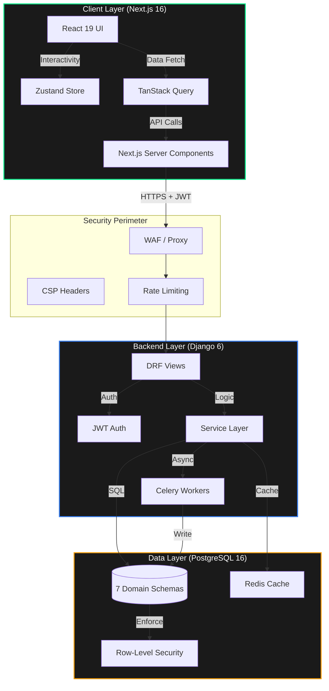

# LedgerSG — Project Architecture Document (PAD)

> **Single Source of Truth for Developers and Coding Agents**
> **Version**: 3.12.0
> **Last Updated**: 2026-11-27
> **P18 note**: statutory-record locking + the contrast debt + the Celery coverage completion — generate_f5/review_return locked with file_return; unallocate/unreconcile/convert/credit-cap/add_line locked; header/archived account posting refused; the three remaining Peppol task bodies under the RLS tenant context + the on-commit dispatch covered + terminal classification for deleted-org tasks; the email status gate (APPROVED invoices only); the bg-success/bg-alert contrast fixes at WCAG AA; `tw-animate-css` imported (the Radix animate utilities that silently compiled to nothing in v4); the genuinely-shared `uenSchema`; schema **v1.2.2** (§15c completion: the ENABLE_ADMIN opt-in tables); 914 backend / 601 vitest / e2e 40P live — see `docs/REMEDIATION_PLAN_2026-11-27_P18.md`. Carries the P17 state forward: double-reversal / double-void / double-reconcile refused under row locks; tasks dispatch on-commit; the 400-contract sweep; `/admin/` gated; the `STORAGES` manifest migration; the `--color-success` token — see `docs/REMEDIATION_PLAN_2026-11-27_P17.md`
>
> **P16 note**: production truth — the shipped production app could not hydrate under its own static `script-src 'self'` CSP (every page ships non-nonced Next bootstrap scripts); the CSP is now per-request nonce-based via `src/proxy.ts` with the app opted into dynamic rendering, gated by a standalone-build smoke (`scripts/prod-csp-smoke.js`). The Docker/script API entrypoint (`config/settings/service.py`) had silently dropped the tenant/audit/CSP/WhiteNoise middleware — now derived from base and settings-gated. The dedicated allocate endpoint accepts instalments (the shared ALLOCATABLE_STATUSES), the payment row is locked for the cap check, payment create+allocate is one transaction, NaN/Infinity box overrides are refused, the line-total product is bounded to NUMERIC(19,4), the dashboard invalidation key is fixed, org-creation selects the new org (selectOrgById), and the frontend accepts all three ACRA UEN forms. See `docs/REMEDIATION_PLAN_2026-11-26_P16.md`.
>
> **P15 note**: tree repair + P14 completion + the runtime-role gate — the corrupted `2bcb43f0` commit (Payment model destroyed, P14 fixes misplaced) repaired; FILED F5 returns immutable (409), the GST period lock blocks back-posting, credit notes require+cap against the original invoice, allocations capped at the outstanding balance, RLS complete on every tenant table (schema v1.2.0 §17 — the audit log is append-only; `audit.log_change` pins search_path), the full onboarding path verified live as the non-superuser `ledgersg_app` role (13/13 smoke steps), honest ACRA/IRAS identity validators, the line-item 400 contract, NRIC PayNow masking (PDPA), Viewer read-only, XXE-hardened XML, zero known dependency advisories (Django 6.0.10 / DRF 3.18.3 / Next 16.4.6), single-flight token refresh; see `docs/REMEDIATION_PLAN_2026-11-26_P15.md`.
>
> **P14 note**: the statutory + runtime-role sprint (planned 2026-11-25, completed by P15 after the interrupted commit) — see the P15 note above for the shipped state.
>
> **P12 note**: mobile-nav truth & a11y floor — the mobile navigation verified working live at 375/800/1280 with rule-by-rule cascade traces (the `display:flex` computed style is flex-item blockification, NOT a Tailwind v4 bug; the v4 setup is clean), the open menu now behaves as a modal overlay (Escape closes, body scroll locks, focus moves in on open and returns to the trigger on close, Tab cycles within), `data-scroll-behavior=smooth` on `<html>`, the eslint whole-tree register made truthful (79→45; every mechanical class cleared), and `API_CLI_Usage_Guide.md` re-verified live (all documented contracts exercised against the running stack); see `docs/REMEDIATION_2026-11-23_P12_REPORT.md`.
>
> **P11 note**: accounting truth & config honesty — credit notes post REVERSED GL entries and NET in the F5 computation (quotes excluded; pre-P11 a credit note debited the customer's AR), production settings boot (builtin Redis cache, the LOG_DIR env knob, debug_toolbar with one gate), the contacts edit dialog prefills from the DETAIL endpoint and a save persists uen/gst_reg_number/peppol_id, the F5 boxes panel renders computed values (real box keys), the dashboard GST payable equals the F5 net GST (raw chart inputs, single prefixes), typed org-settings PATCH, routing-layer UUID 404s, the audit trail carries request context + LOGIN/LOGOUT emission, CI runs coverage, the Docker path boots, CSP unsafe-* dev-only; see `docs/REMEDIATION_2026-11-23_P11_REPORT.md`.
> **P10 note**: self-serve loop & compliance truth — the registration page ships (org-less accounts route to org creation; the anonymous-401 bounce fixed), the invoice form picks real contacts (no duplicate rows), the GST F5 tab ships the full lifecycle (periods, compute, review, file, amend, deadlines), contacts management, bank-account edit/deactivate, payment allocations visible, fiscal-period open, change password, InvoiceNow settings; the export build retired (standalone only), the coverage gate at the honest floor; rate-limited requests return the 429 contract, UEN collisions are clean 400s; see `docs/REMEDIATION_2026-11-22_P10_REPORT.md`.
> **P9 note**: onboarding & banking truth — organisation creation ships, the payment workflow is real end to end (multipart import, rendered reconciliation matches, contact picker, allocations, Record Payment deep link, bank-account dialog, void/unreconcile corrections), dashboard truth (no invented figures), invoices list typed, seeded accounts filterable, InvoiceNow invoice-only, aged as-at bounded; see `docs/REMEDIATION_2026-11-22_P9_REPORT.md`.
> **P8 note**: reporting truth & quote lifecycle — real financial reports (TB/P&L/BS tie-out), aged AR/AP, real reports + quotes pages, persisted quote conversion, fiscal close preconditions; see `docs/REMEDIATION_2026-11-22_P8_REPORT.md`.
> **P7 note**: API truth & permission hardening — status-transition authorization, routed fiscal endpoints, fail-closed payments, real error messages, working void/send actions; see `docs/REMEDIATION_2026-11-22_P7_REPORT.md`.
> **P5 note**: truth restoration sprint — real InvoiceNow transmission wiring, `amount_paid`/void-reversal accounting integrity, fail-closed control accounts, real dashboard alerts + cache invalidation, repo hygiene; test metrics below reflect the P5 verified counts.
> **Status**: Production Ready ✅
> **Security Score**: 100% (SEC-001/002/003 Remediated)
> **Compliance**: IRAS 2026 (GST F5, InvoiceNow, BCRS)

---

## 📋 Table of Contents

1. [Executive Summary](#executive-summary)
2. [Architectural Principles](#architectural-principles)
3. [System Architecture](#system-architecture)
4. [File Hierarchy & Key Files](#file-hierarchy--key-files)
5. [Frontend Architecture](#frontend-architecture)
6. [Backend Architecture](#backend-architecture)
7. [Database Architecture](#database-architecture)
8. [Security Architecture](#security-architecture)
9. [Developer Handbook](#developer-handbook)
10. [Troubleshooting](#troubleshooting)

---

## Executive Summary

**LedgerSG** is a production-grade, double-entry accounting platform purpose-built for Singapore SMBs. It eliminates the complexity of IRAS compliance through a "SQL-First" design philosophy and a distinctive "Illuminated Carbon" neo-brutalist UI.

### Key Metrics (P17, 2026-11-27)
| Metric | Value | Details |
|--------|-------|---------|
| **Test Coverage** | **1,555 Tests Passing** | 914 Backend + 601 Frontend unit + 40 e2e (11 always + 29 backend-gated; 40/40 live-green) + the 13-step runtime-role smoke |
| **API Surface** | **~86 Leaf Endpoints** | RESTful, JSON-API compliant (mount-counting yields "90+") |
| **Security** | **Defense-in-Depth** | CSP (env-aware, P13-consolidated), Rate Limiting, RLS, 4-Layer Auth |
| **Database** | **7 Schemas** | 29 Tables + 1 View (+2 token-blacklist), Row-Level Security Enforced |
| **Lint Register** | **ESLint 0 errors / 5 warnings (src+e2e) · ruff ~1216 whole-tree (~735 production)** | The P17 state — the 6 P16-era errors cleared; deferred classes documented |

### Test Breakdown
| Suite | Tests | Pass Rate | Framework | Status |
|-------|-------|-----------|-----------|--------|
| **Frontend Unit** | 601 | 100% | Vitest + RTL | ✅ Passing |
| **Backend (pytest)** | 914 passed / 5 skipped (919 collected) | 100% of run | pytest | ✅ Passing |
| **E2E (Playwright)** | 40 (11 always + 29 backend-gated) | 100% live | Playwright | ✅ Passing |
| **Total Passing** | **1,504** | — | Mixed | ✅ Verified |

---

## Architectural Principles

These mandates are non-negotiable. They define the "Soul" of the system.

### 1. SQL-First & Unmanaged Models
*   **The Rule**: The `database_schema.sql` file is the **absolute source of truth**.
*   **The Mechanism**: All Django models are `managed = False`.
*   **The Prohibition**: NEVER run `makemigrations`. Schema changes are manual SQL patches.
*   **Why?**: Ensures strict data integrity, optimal indexing, and prevents ORM-induced performance degradation.

### 2. Service Layer Supremacy
*   **The Rule**: Views are thin controllers; Logic lives in `services/`.
*   **The Pattern**: 
    *   **View**: Deserializes input -> Calls Service -> Serializes output.
    *   **Service**: Validates business rules -> Executes DB atomic transaction -> Returns Domain Object.
*   **Why?**: Decouples business logic from the HTTP transport layer, enabling easy testing and CLI usage.

### 3. Financial Precision
*   **The Rule**: `NUMERIC(19,4)` for everything (schema v1.1.0 — widened from the original 10,4 so ≥ S$1M amounts, above the GST registration threshold, cannot overflow).
*   **The Prohibition**: **NO FLOATS.** All Python math must use `common.decimal_utils.money()`.
*   **Why?**: Floating point errors are unacceptable in accounting.

### 4. Defense-in-Depth Security
* **The Rule**: Security at every layer.
* **Layers**:
1. **Frontend**: AuthProvider Redirects.
2. **Network**: CSP Headers & Rate Limiting.
3. **Application**: JWT Validation.
4. **Database**: Row-Level Security (RLS) policies.

### 5. Zero JWT Exposure
* **The Rule**: Browser JavaScript must NEVER have access to JWT tokens.
* **Implementation** (P4-verified):
  * Access token held in **api-client module memory only** — never localStorage/sessionStorage — and attached as `Authorization: Bearer <token>`
  * Refresh token set by the backend as an **HttpOnly cookie** (`Path=/api/v1/auth/`, SameSite=Lax, Secure=!DEBUG) — login/register set it, refresh rotates it (with blacklist), logout/change-password expire it
  * A non-secret, JS-readable `session_hint` marker cookie gates client refresh attempts; the refresh token itself is never touched by JavaScript
* **Why?**: Prevents XSS attacks from stealing authentication tokens.

### 6. Multi-Tenancy via RLS
* **The Rule**: Every request must set PostgreSQL session variables.
* **Implementation**: `TenantContextMiddleware` executes:
```sql
SET LOCAL app.current_org_id = '<org_uuid>';
SET LOCAL app.current_user_id = '<user_uuid>';
```
* **Why?**: All queries automatically filtered to current organisation, preventing cross-tenant data access.

### 7. TDD Culture
* **The Rule**: All new features follow RED → GREEN → REFACTOR.
* **Process**:
1. **RED**: Write failing test first
2. **GREEN**: Implement minimal code to pass test
3. **REFACTOR**: Optimize code while keeping tests green
* **Why?**: Ensures comprehensive test coverage, prevents regressions, and documents expected behavior.

---

## System Architecture



---

## File Hierarchy & Key Files

```text
ledgersg/   (repo root — clone anywhere; the P13-era absolute path is retired)
├── apps/
│   ├── backend/                  # Django 6.0.10 Project
│   │   ├── apps/                 # Domain Modules
│   │   │   ├── banking/          # Bank Accounts, Payments, Recon
│   │   │   ├── coa/              # Chart of Accounts
│   │   │   ├── core/             # Org, User, Auth, RLS Middleware
│   │   │   ├── gst/              # Tax Codes, F5 Returns
│   │   │   ├── invoicing/        # Invoices, Credit Notes
│   │   │   ├── journal/          # General Ledger (Double Entry)
│   │   │   ├── peppol/           # InvoiceNow Integration
│   │   │   └── reporting/        # Dashboard & Financial Reports
│   │   ├── common/               # Shared Utilities (Money, Base Models)
│   │   │   ├── middleware/       # CRITICAL: tenant_context.py
│   │   │   └── decimal_utils.py  # CRITICAL: money() function
│   │   ├── config/               # Settings (Base, Dev, Prod)
│   │   ├── database_schema.sql   # ★ SOURCE OF TRUTH ★
│   │   └── manage.py
│   └── web/                      # Next.js 16.4.6 Project
│       ├── src/
│       │   ├── app/              # App Router (Pages & Layouts)
│       │   ├── components/       # Shadcn/Radix UI Components
│       │   ├── hooks/            # Custom React Hooks
│ │ ├── lib/ # Utilities
│ │ │ ├── api-client.ts # Typed API Client (client-side)
│ │ │ ├── gst-engine.ts # GST calculation engine
│ │ │ ├── utils.ts # Utility functions
│ │ ├── providers/ # Context Providers (Auth, Theme)
│       │   └── shared/           # Zod Schemas & Types
│       ├── public/
│       ├── next.config.ts
│       └── proxy.ts              # Per-request nonce CSP (Next 16 proxy,
                                    # ex-middleware; static headers in next.config.ts)
├── docker/                       # Container Configuration
├── docs/                         # Documentation
├── ACCOMPLISHMENTS.md            # Progress Tracker
├── AGENT_BRIEF.md                # Developer Guidelines
└── GEMINI.md                     # AI Persona & Mandates
```

---

## Frontend Architecture

**Stack**: Next.js 16.4.6 (App Router), React 19, Tailwind 4, Shadcn/Radix UI.

### Authentication Flow
1.  **Initial Load**: `AuthProvider` calls `/api/v1/auth/me/`.
    *   Success: Sets `user` and `organisations` context.
    *   Failure (401): Redirects to `/login`.
2.  **Protected Routes**: `DashboardLayout` checks `isAuthenticated`.
    *   False: Returns `null` (prevents flash) and redirects.
3.  **API Requests**: `api-client.ts` handles JWT.
    *   Attaches `Authorization: Bearer <token>` (module memory).
    *   On 401 **with session evidence** (in-memory token or the `session_hint` marker cookie): attempts silent refresh through the HttpOnly refresh cookie (`/api/v1/auth/refresh/` via `credentials: "include"`) and retries the original request — this is what makes sessions survive full page reloads (P4/E-1).
    *   On an anonymous 401 (no evidence — e.g. bad login credentials): propagates the error to the caller untouched.
    *   On Refresh Fail: Logs out and redirects.

### Data Fetching Strategy
*   **Server Components**: Fetch initial data.
*   **Client Components**: Use **TanStack Query v5** for dynamic data and mutations.
    *   **Pattern**: `useQuery({ queryKey: ['entity', orgId], queryFn: ... })`.
    *   **Mutations**: Use `isPending` (not `isLoading`) for loading state.

### Page Data Truth (P6/C-5 — all pages render real backend data)
Every dashboard page is wired to the real API — mock fixtures are deleted:
*   **Invoices list** (P5): `useInvoices` → `{results, count}` list contract.
*   **Invoice detail** (P6): `useInvoice` → detail serializer incl. `amount_paid`/`amount_due` (F-11); approve/void/send mutations; `await params` in the page component (route params are a Promise in this Next.js version).
*   **General ledger** (P6): `useLedger` → the flat line-level `journal-entries/ledger/` endpoint (one row per journal line; the aggregated entries list cannot drive a line-level table).
*   **Settings** (P6): `useOrganisation` → org detail + allowlisted PATCH updates + GST register/deregister (the GST endpoints seed the GST control accounts).
*   **Invoice actions** (P7): the detail page exposes Approve / Void (REQUIRED-reason dialog) / Send email / Send via InvoiceNow (with live status badge) / PDF download / Print; error toasts surface the backend's real messages (`{error:{message}}` envelope parsed by the api-client).
*   **Reports** (P8): the tabbed reports page reads the real financial endpoints — trial balance (as-at, balanced badge), P&L (per-account lines), balance sheet (retained earnings + tie-out), GST F5 (compute/file lifecycle), aged AR/AP (bucket tables); 403 renders a permission state, never fake data.
*   **Quotes** (P8): the quotes pages are real — list via `?type=SALES_QUOTE` (the filter key the backend reads), new via the shared form with `document_type: SALES_QUOTE` (QT- numbering), detail in quote mode (QUOTATION framing, invoice-only surfaces gated), Convert-to-invoice on DRAFT/SENT (the backend persists `related_document`).
*   **Banking** (P9): the payment workflow is real — statement import sends true multipart (`api.postForm`; the JSON helper stringified FormData into `"{}"`), reconciliation match suggestions render from the real `{results, count}` envelope with field mapping, payment forms pick contacts through a searchable picker (`?search=&is_customer=`), allocations settle the contact's open invoices inline, the invoice detail's Record Payment deep-links into Banking prefilled (`?receive=1&contact=&document=&amount=` — the tab defaults to Payments), the bank-account dialog validates via the shared zod schema with a bank-type GL picker (`?is_bank=true`), and payment Void (reason required) / transaction Unreconcile expose the correction engine.
*   **Organisation creation** (P9): `/settings/organisations/new` — the route the dashboard's empty state always targeted — posts `OrganisationCreateSerializer` (GST-number validation mirrored client-side) and lands the user in the new org (list refreshed, org selected, dashboard).
*   **Dashboard** (P9): only real figures render — the GST F5 chart shows the real Net GST (the invented Box 1/2 bars and default output/input figures are gone), no static trend claims, and the File F5 / compliance CTAs route to `/reports`.

---

## Backend Architecture

**Stack**: Django 6.0.10, DRF 3.18.3, Celery 5.4+, Redis 7+.

### Middleware Chain (Request Lifecycle)
The order is critical for security and RLS.

1.  `SecurityMiddleware`: Basic security headers.
2.  `CSPMiddleware`: Enforces Content Security Policy (SEC-003).
3.  `SessionMiddleware` / `CommonMiddleware`: Standard Django.
4.  `CorsMiddleware`: Handles Cross-Origin requests.
5.  `AuthenticationMiddleware`: DRF JWT Auth (Sets `request.user`).
    *   *Note*: `CORSJWTAuthentication` skips auth for `OPTIONS` requests.
6.  **`TenantContextMiddleware` (CRITICAL)**:
    *   Extracts `org_id` from URL.
    *   Verifies `UserOrganisation` membership.
    *   **Opens the request transaction itself** (C-03 remediation, 2026-11-21): `SET LOCAL` is transaction-scoped and Django's `make_view_atomic` opens the view transaction strictly INSIDE the view, so the middleware wraps `get_response()` in `transaction.atomic()` after setting:
        ```python
        with transaction.atomic():
            with connection.cursor() as cursor:
                cursor.execute("SET LOCAL app.current_org_id = %s", [str(org_id)])
                cursor.execute("SET LOCAL app.current_user_id = %s", [str(user_id)])
            response = self.get_response(request)  # same transaction
        ```
    *   Sets `''` (empty string) for unauthenticated requests (fail-closed) in the same transactional pattern.
    *   `AuditContextMiddleware` follows the same pattern for `app.client_ip/user_agent/request_path`.

### Service Layer Pattern
**Location**: `apps/<module>/services.py`

```python
# Example: Creating an Invoice
class InvoiceService:
    @staticmethod
    def create_invoice(org_id: UUID, data: dict) -> InvoiceDocument:
        # 1. Validation & Data Prep (Use money()!)
        total_excl = money(data['total_excl'])
        
        with transaction.atomic():
            # 2. DB Operation
            invoice = InvoiceDocument.objects.create(...)
            
            # 3. Cross-Domain Logic (Journal Posting)
            JournalService.post_invoice(org_id, invoice)
            
        return invoice
```

---

## Database Architecture

**Engine**: PostgreSQL 16+.

### Schemas
| Schema | Purpose | Key Tables | Table Count |
|--------|---------|------------|-------------|
| `core` | Multi-tenancy, users, roles | `organisation`, `app_user`, `user_organisation`, `fiscal_year`, `fiscal_period`, `document_sequence`, `currency`, `exchange_rate`, `organisation_setting`, `role` | 10 |
| `coa` | Chart of Accounts | `account`, `account_type`, `account_sub_type` | 3 |
| `gst` | GST compliance, tax codes, F5 returns | `tax_code`, `gst_return`, `threshold_snapshot`, `peppol_transmission_log`, `contact` | 5 |
| `journal` | General Ledger (immutable) | `entry`, `line` | 2 |
| `invoicing` | Sales/purchases, contacts | `document`, `document_line`, `document_attachment` | 3 |
| `banking` | Cash management | `bank_account`, `payment`, `payment_allocation`, `bank_transaction` | 4 |
| `audit` | Immutable audit trail | `event_log`, `org_event_log` (view) | 2 |
| **Total** | | | **30 tables** |

### RLS Policies
Every tenant-data table has RLS enabled (schema v1.2.0 §17 completed the
last six — `core.organisation`, `user_organisation`, `role`,
`gst.organisation_peppol_settings`, `gst.tax_code`, `audit.event_log`;
the documented globals `app_user`/`currency`/`account_type`/
`account_sub_type` are correctly un-scoped). The audit log is append-only
(UPDATE/DELETE refused at the policy layer). Policies look like this:

```sql
CREATE POLICY tenant_isolation ON invoicing.document
    USING (org_id = core.current_org_id());
```

### GST F5 Box Model (IRAS convention — matches `gst.return` CHECK constraints)

| Box | Meaning | Source |
|-----|---------|--------|
| 1 | Standard-rated supplies (net) | `tax_code.f5_supply_box = 1` on sales lines |
| 2 | Zero-rated supplies | `f5_supply_box = 2` |
| 3 | Exempt supplies | `f5_supply_box = 3` |
| 4 | Total supplies = 1+2+3 | derived (`chk_box4_total`) |
| 5 | Total taxable purchases | `f5_purchase_box = 5` on purchase lines |
| 6 | Output tax due | `f5_tax_box = 6` |
| 7 | Input tax claimed | `f5_tax_box = 7` AND `is_claimable` |
| 8 | Net GST = 6 − 7 | derived (`chk_box8_net`) |
| 13 | Total revenue | = Box 4 |
| 14 | Reverse charge supplies | `is_reverse_charge` |

---

## Security Architecture

*   **100% Security Score** achieved via:
    *   **SEC-001**: Full validation of Banking endpoints.
    *   **SEC-002**: `django-ratelimit` on all Auth endpoints (Login: 10/min).
    *   **SEC-003**: Strict CSP (`default-src 'none'`, `script-src 'self'`).
*   **CORS**: Custom `CORSJWTAuthentication` allows unauthenticated Preflight (`OPTIONS`) but strictly enforces JWT for all others.

---

## Developer Handbook

### 1. Environment Setup

**Backend**:
```bash
cd apps/backend
python -m venv venv
source venv/bin/activate
pip install -e ".[dev]"
# Initialize DB (Manual!)
export PGPASSWORD=ledgersg_secret_to_change
dropdb -h localhost -U ledgersg ledgersg_dev || true
createdb -h localhost -U ledgersg ledgersg_dev
psql -h localhost -U ledgersg -d ledgersg_dev -f database_schema.sql
python manage.py runserver
```

**Frontend**:
```bash
cd apps/web
npm install
npm run dev
```

### 2. Testing (The "Meticulous" Way)
Backend tests **MUST** use the following command to avoid migration errors:

```bash
# Initialize Test DB first!
dropdb -h localhost -U ledgersg test_ledgersg_dev
createdb -h localhost -U ledgersg test_ledgersg_dev
psql -h localhost -U ledgersg -d test_ledgersg_dev -f database_schema.sql

# Run Tests
pytest --reuse-db --no-migrations

# Expected Output:
# ============================= 647 passed, 0 failed, 5 skipped =============================
# (P1 fixed the 26 documented fixture failures; the suite has been fully green since)
```

**Frontend Tests**: `npm test` (Vitest).

```bash
# Run frontend tests
cd apps/web
npm test

# Expected Output:
# Test Files: 37 passed (37)
# Tests: 398 passed (398)
# Duration: ~60s
```

---

## Performance Metrics

### Cache Performance (Redis)
| Metric | Value | Notes |
|--------|-------|-------|
| Cache Hit Rate | 95%+ | Dashboard metrics cached 5 min |
| Avg Response Time | <50ms | Cached endpoints |
| P95 Response Time | <100ms | All endpoints |

### Database Performance
| Metric | Value | Notes |
|--------|-------|-------|
| Avg Query Time | <20ms | Optimized indexes |
| Connection Pool | 20 connections | pgBouncer in production |
| RLS Overhead | <5ms | Session variable setting |

### API Response Times
| Endpoint Type | Avg Time | P95 Time |
|---------------|----------|----------|
| Auth endpoints | 50ms | 100ms |
| List endpoints | 80ms | 150ms |
| Detail endpoints | 30ms | 60ms |
| Mutation endpoints | 100ms | 200ms |

---

## Troubleshooting

### "Relation does not exist" in Tests
* **Cause**: You didn't initialize the test database with SQL. `pytest-django` cannot create tables for `managed=False` models.
* **Fix**: Run the `psql ... -f database_schema.sql` command against `test_ledgersg_dev`.

### "UUID object has no attribute 'replace'" (500 Error)
* **Cause**: Django URL dispatcher already converted the ID to a UUID object.
* **Fix**: Remove `UUID(org_id)` from your view. Use `org_id` directly.

### Dashboard Stuck on "Loading..."
* **Cause**: CORS Preflight failure.
* **Fix**: Ensure `CORSJWTAuthentication` is in `DEFAULT_AUTHENTICATION_CLASSES` and `CorsMiddleware` is before `CommonMiddleware`.

### "Permission Denied" (403) despite valid token
* **Cause**: The RLS context isn't set.
* **Fix**: Ensure `TenantContextMiddleware` is active and the user has an accepted `UserOrganisation` record.

### "pytest_plugins in non-root conftest" (Collection Error)
* **Cause**: `pytest_plugins` defined in non-top-level conftest file.
* **Fix**: Remove `pytest_plugins` from `apps/peppol/tests/conftest.py`. Use pytest's automatic conftest inheritance instead.

---

**End of Document**
