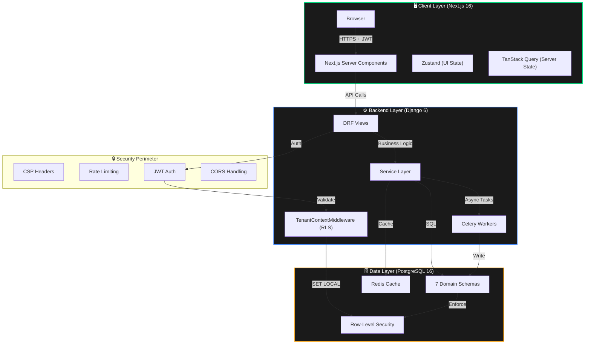
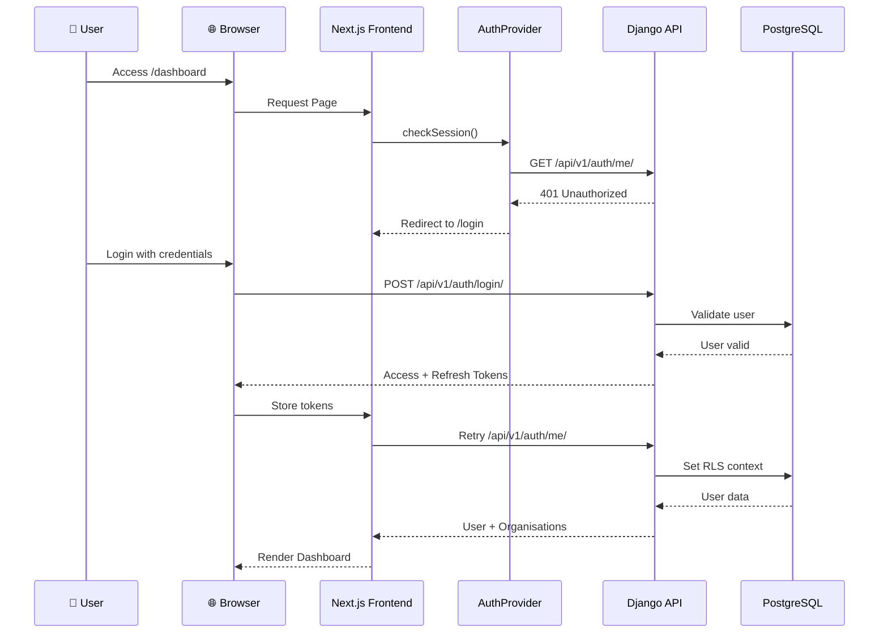
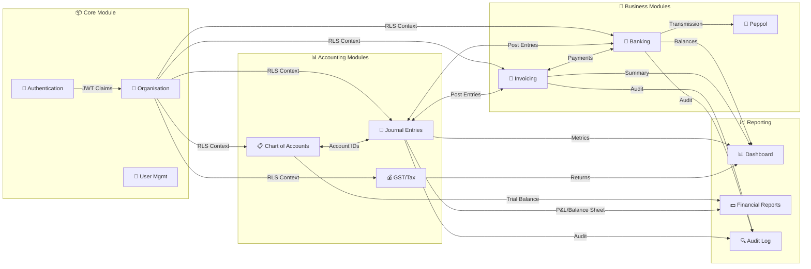

# LedgerSG — Enterprise Accounting Platform for Singapore SMBs

[]()
[]()
[]()
[]()
[]()
[]()
[]()
[]()

**Production-Grade Double-Entry Accounting for Singapore SMBs**

SQL-First • Service-Oriented • RLS-Enforced • Illuminated Carbon UI • IRAS Compliant

> *Unlike traditional accounting software designed for human clicks, LedgerSG is designed for **AI agent automation** - making it the first accounting platform built for the AI-first era.*

---

## 📋 Table of Contents

- [🎯 Project Overview](#-project-overview)
- [✨ Key Features](#-key-features)
- [📊 Current Status](#-current-status)
- [🧪 Test Suites & Execution](#-test-suites--execution)
- [🏗 System Architecture](#-system-architecture)
- [📁 Project Structure](#-project-structure)
- [💻 Technology Stack](#-technology-stack)
- [🚀 Quick Start](#-quick-start)
- [⚙️ Configuration](#️-configuration)
- [🔐 Security Posture](#-security-posture)
- [📜 Compliance](#-compliance)
- [🐳 Deployment](#-deployment)
- [🔧 Troubleshooting](#-troubleshooting)
- [🤝 Contributing](#-contributing)
- [📚 Documentation](#-documentation)
- [📈 Roadmap](#-roadmap)
- [📄 License](#-license)

---

## 🎯 Project Overview

**LedgerSG** is a high-integrity, double-entry accounting platform purpose-built for Singapore small and medium businesses (SMBs). It transforms IRAS 2026 compliance from a regulatory burden into a seamless, automated experience while delivering a distinctive **"Illuminated Carbon"** neo-brutalist user interface.

### Core Mission

> Transform IRAS compliance from a burden into a seamless, automated experience while delivering a distinctive, anti-generic user interface that makes financial data approachable yet authoritative.

### Target Audience

- Singapore SMBs (Sole Proprietorships, Partnerships, Pte Ltd)
- Accounting Firms managing multiple client organisations
- GST-Registered Businesses requiring F5 return automation
- Non-GST Businesses tracking threshold compliance

### Key Differentiators

| Feature | LedgerSG | Generic Solutions |
|---------|----------|-------------------|
| IRAS Compliance | ✅ Native (GST F5, InvoiceNow, BCRS) | ⚠️ Add-ons required |
| Database Security | ✅ PostgreSQL RLS at schema level | ⚠️ Application-layer only |
| Financial Precision | ✅ NUMERIC(19,4), no floats | ⚠️ Often uses floats |
| Multi-Tenancy | ✅ Database-enforced isolation | ⚠️ Shared tables |
| Audit Trail | ✅ Immutable 5-year retention | ⚠️ Configurable |
| UI Design | ✅ Distinctive "Illuminated Carbon" | ❌ Generic templates |

---

## ✨ Key Features

### Compliance Features

| Feature | GST-Registered | Non-Registered | Status |
|---------|----------------|----------------|--------|
| Standard-rated (SR 9%) invoicing | ✅ | ❌ (OS only) | ✅ Complete |
| Zero-rated (ZR) export invoicing | ✅ | ❌ | ✅ Complete |
| Tax Invoice label (IRAS Reg 11) | ✅ | ❌ | ✅ Complete |
| GST Registration Number on invoices | ✅ | ❌ | ✅ Complete |
| Input tax claim tracking | ✅ | ❌ | ✅ Complete |
| GST F5 return auto-generation | ✅ | ❌ | ✅ Complete |
| GST threshold monitoring ($1M) | ❌ | ✅ (critical) | ✅ Complete |
| InvoiceNow/Peppol transmission | ✅ (mandatory) | Optional | ✅ Complete (Phases 1-4) |
| BCRS deposit handling | ✅ | ✅ | ✅ Complete |
| 5-year document retention | ✅ | ✅ | ✅ Complete |

### Technical Features

- **Double-Entry Integrity** — Every transaction produces balanced debits/credits enforced at database level
- **NUMERIC(19,4) Monetary Precision** — No floating-point arithmetic; all amounts stored as DECIMAL in PostgreSQL (capacity above the S$1M GST registration threshold — schema v1.1.0)
- **Real-Time GST Calculation** — Client-side preview with Decimal.js, server-side authoritative calculation
- **Immutable Audit Trail** — All financial mutations logged with before/after values, user, timestamp, IP
- **PDF Document Generation** — IRAS-compliant tax invoices via WeasyPrint 68.1
- **Email Delivery Service** — Asynchronous invoice distribution with attachments via Celery
- **WCAG AAA Accessibility** — Screen reader support, keyboard navigation, reduced motion respect
- **Multi-Tenant Isolation** — PostgreSQL Row-Level Security (RLS) with session variables

---

## 📊 Current Status

| Component | Version | Status | Key Metrics |
|-----------|---------|--------|-------------|
| **Frontend** | v0.1.6 | ✅ Production Ready | 12 pages, **383 unit tests + 20 e2e** (9 always + 11 backend-gated), typecheck clean, WCAG axe-clean login flow, cross-reload session persistence, real invoices list/detail + ledger + settings pages (P5/P6) |
| **Backend** | v0.4.0 | ✅ Suite Fully Green | 89+ endpoints, **588 tests passing** (0 failed), SQL-First, RLS transaction-scoped, HttpOnly refresh-cookie auth, real InvoiceNow wiring + accounting truth: exact payment control accounts, PARTIALLY_PAID allocations, unallocate recompute (P5/P6) |
| **Database** | v1.1.0 | ✅ Complete | 7 schemas + token blacklist, RLS enforced, 30 domain tables, **NUMERIC(19,4) money** |
| **Accounting Engine** | v1.0.0 | ✅ Verified | 3/3 E2E Workflows (Lakshmi, ABC, Meridian) |
| **Banking UI** | v1.3.0 | ✅ Phase 5.5 Complete | 73 TDD tests, all 3 tabs live, reconciliation |
| **Dashboard** | v1.1.0 | ✅ Phase 4 Complete | 36 TDD tests, Redis caching |
| **InvoiceNow** | v0.6.0 | ✅ Real transmission path (P5/C-2) | send-invoicenow creates a real transmission log + queues the Celery task; status reports real log rows; retention-safe cleanup (never deletes DELIVERED/REJECTED) |
| **Security** | v1.2.0 | ✅ P0 Hardened + P4 Cookie Auth | Token rotation + blacklist, SECRET_KEY gate, rate limiting default-on, HttpOnly refresh cookie + `session_hint` evidence gate |
| **Overall** | — | 🟢 **P0–P6 Remediated; all gates green** | See `docs/REMEDIATION_2026-11-21_REPORT.md`, `_P1…_P6_REPORT.md` and `docs/ledgersg-audit-report.md` |

### Latest Milestone

#### 🎉 P6 Sprint: C-5 Completion & Payment Posting Integrity — 2026-11-22 (session 12)

Source: the post-P5 audit re-verified in source (`docs/REMEDIATION_PLAN_2026-11-22_P6.md`).

- ✅ **PARTIALLY_PAID is no longer a dead end** (F-4): `allocate()` accepts second allocations — P5/H-1 persisted the status but the guard was never widened
- ✅ **Exact payment control accounts** (F-5/F-6): the payment journal entry resolves AR/AP through the P5/H-4 fail-closed resolver (1200/2100) instead of a broad `Q(account_type=…).first()` that could post AR to 1010 Cash on Hand; `create_contact` assigns default AR/AP control accounts so the normal path never depends on the fallback
- ✅ **unallocate() recomputes** (F-7): `amount_paid`/status/`amount_due` stay truthful after an allocation is removed (P5/H-1 covered allocate/void only)
- ✅ **Organisation address is updatable** (F-10): both update allowlists forwarded a phantom `address` key the model does not have while filtering out the real fields (`address_line_1/2`, `city`, `postal_code`, `country`)
- ✅ **Invoice detail truth** (F-11): the detail serializer exposes `amount_paid`/`amount_due`; the detail page is real end-to-end (status, lines, totals, payment state, approve/void/send mutations, `await params`)
- ✅ **Real ledger page** (C-5): new flat line-level `journal-entries/ledger/` endpoint + `useLedger` + props-driven table — one row per journal line
- ✅ **Real settings page** (C-5): controlled inputs over the real organisation, GST register/deregister wiring (seeds the GST control accounts)
- ✅ **e2e-friendly rate budgets as settings** (E-1): `REFRESH_RATELIMIT_IP` knob (production 20/min unchanged), development raises refresh + DRF budgets; the testing-settings REST_FRAMEWORK override made copy-on-write (it corrupted the shared base dict)
- ✅ **C-5 closed**: every dashboard page now renders real backend data (mock fixtures deleted)

#### 🎉 P5 Sprint: Truth Restoration — Repo Hygiene, Real InvoiceNow, Accounting Integrity & Real Dashboard Data — 2026-11-21 (session 11)

Source: the independent audit (`docs/ledgersg-audit-report.md`, every Critical/High finding re-verified in source before planning).

- ✅ **Repo hygiene** (C-1/C-3/H-9): `.env`/`.env.local` (re-added by a P4 `git add -A`), 211 `.pyc`, 54 `dist/` and 10 `.bak` files untracked; `.gitignore` completed; CI's embedded DB password replaced by a per-run generated credential; `testing.py` reads `DB_*` from env
- ✅ **Real InvoiceNow** (C-2 + a newly-found wiring bug): `send-invoicenow` creates a real `PeppolTransmissionLog` and queues the transmission task; `invoicenow-status` reports the real log rows; the task/service seam passed a LOG id where an INVOICE id was expected — the auto-transmit path could never succeed; `check_transmission_status_task` wired to the AP adapter; cleanup is retention-safe (never deletes DELIVERED/REJECTED — IRAS 5-year evidence)
- ✅ **Accounting truth** (H-1/H-2): `allocate()` persists `document.amount_paid` (outstanding AR/AP were permanently overstated); payment `void()` posts a reversing journal entry and releases allocations
- ✅ **Control accounts, fail-closed** (H-4): AR=1200, AP=2100, GST input=1600, GST output=2600 — the old broad `.first()` resolvers posted output tax to 2200 Accrued Expenses; a GST-bearing line without control accounts now raises instead of guessing
- ✅ **Money & line integrity** (H-5/H-6): line amounts reconcile to the cent with the GST base; duplicate journal lines get distinct line numbers
- ✅ **Dashboard truth** (H-3/H-10): mutations invalidate the 5-minute dashboard cache (approve/void, payments, GST filing); the alerts view computes real overdue/unreconciled/unpaid-bill counts instead of placeholder zeros
- ✅ **Org service** (M-5/M-6/M-7): GST registration seeds the control accounts (the old guard was dead code); `update_organisation` is allow-listed at the service boundary; dead `_create_document_sequences` removed
- ✅ **Real invoices list page** (C-5 part 1): mock data deleted, `useInvoices` wired with truthful loading/error/empty states; the hook retyped to the real backend row shape

#### 🎉 P4 Sprint: Cross-Reload Session Persistence & Suite Depth — 2026-11-21 (session 9)

- ✅ **Sessions survive page reloads, new tabs and browser restarts** (E-1, a three-link defect chain): the backend now sets the refresh token as an **HttpOnly cookie** (login/register set it, refresh rotates it, logout/change-password expire it — zero frontend transport changes, backward-compatible body flow for API clients), and the api-client refreshes on a cold-401 (no in-memory access token) — the documented 7-day session design finally holds
- ✅ **Evidence-gated refresh** (E-1 refinement, root-caused from the e2e run): refreshing on every 401 turned bad login credentials into a pointless refresh POST that flooded the refresh rate limit and swallowed the login form's error behind a hard redirect — a non-secret, JS-readable `session_hint` marker cookie now gates the refresh attempt; anonymous 401s propagate untouched; dead evidence is expired server-side on failed cookie-refresh
- ✅ **Logout affordance in the shell** — the persisted session got a UI kill switch (logout blacklists + expires both cookies server-side)
- ✅ **Login rates as settings knobs** (`LOGIN_RATELIMIT_IP/USER`) — production defaults unchanged (10/min IP, 30/min user); the development budget covers the 16-test e2e run
- ✅ **Session-persistence e2e spec** (E-5): reload survival, post-reload client navigation, and logout-kills-the-session against the live backend (16 e2e total: 9 always-green + 7 `E2E_API_URL`-gated)
- ✅ **Root `.env.example`** index + docs truth pass (E-2/E-3/E-4)

#### P3 Sprint: Monetary Capacity, Truthful Invoice Form & Suite Depth — 2026-11-21 (session 7)

- ✅ **All 47 monetary columns widened to NUMERIC(19,4) — schema v1.1.0** (deferred H-03): `NUMERIC(10,4)` capped every value at S$999,999.9999, **below the S$1M GST registration threshold** — a GST-registered org's F5 Box 13 revenue or any ≥ S$1M line/document/journal amount raised `numeric field overflow` (verified live). §16 of the schema ships the idempotent in-place migration (incl. the `amount_due` generated-column drop → widen → re-add sequence); the schema-conformance gate now asserts numeric precision per model field, and `add_line` applies `discount_pct` server-side
- ✅ **The New Invoice form actually creates documents** (D-1): the submit path was a TODO stub (`console.log` + mock UUID) with `useCreateInvoice` as dead code; now wired through the real contracts (per-line posting account select, contact → document adapter, server-authoritative recalculation, error banner)
- ✅ **PDF downloads authorized through the api-client** (D-2): the old `localStorage.getItem("accessToken")` read violated the zero-JWT-exposure mandate and sent `Bearer null` on every download; `api.blob()` shares the single fetch+refresh auth path
- ✅ **Server-effective tax codes in the invoice form** (D-3): the dropdown and the preview now use the rows in force on the document's date (`?effective_on=` wiring) instead of the hardcoded 9% map — backdated documents preview at the correct rate
- ✅ **Both test suites extended** (D-5): new auth + invoice-form e2e specs (13 total, backend-gated via `E2E_API_URL` / `npm run test:e2e:full`, green without a backend by default) and 25 new vitest tests (hooks, engine, adapter, form submit)
- ✅ **Fresh-host deployment guide** (`docs/DEPLOYMENT.md`) and complete backend `.env.example` (`ALLOWED_HOSTS`, D-4)

#### P2 Sprint: Test Gates & Rate-Effectiveness Truth — 2026-11-21 (session 5)

- ✅ **GST rate history resolved by effective date, fail-closed** (deferred H-04): `get_tax_code_by_code()` picked arbitrary history rows (verified returning the 2007 7% rate for SR instead of the current 9%); now resolves the row in force on the document date (org rows shadow system rows), `gst/calculate/` 404s on unknown codes instead of silently using 9%, and `add_line` rejects tax codes not in force on the document's own date
- ✅ **Custom tax-code creation un-broken** (B-7): `POST /gst/tax-codes/` always 500'd on a phantom `box_mapping` kwarg; now returns 201 and persists the declared `f5_*` box fields
- ✅ **Both frontend test suites green by default** (B-1): playwright runs chromium out of the box (`PLAYWRIGHT_PROJECTS=all` opts into the 5-browser matrix); the login-page axe scan is deterministic and passes (main landmark + h1 + contrast fixed, B-2)
- ✅ **Typecheck gate green** (B-5): `npm run typecheck` added; 25 pre-existing test-file type errors repaired (jest-style typings → vitest, incomplete fixtures completed)
- ✅ **Truthful `apps/web/.env.example`** (B-4): only variables the code actually reads, plus a clearly-marked reserved section

#### P1 Sprint: Green Suite & Contract Truth — 2026-11-21 (session 3)

- ✅ **Backend test suite fully green for the first time: 499 passed / 0 failed / 5 skipped** (was 26F/465P)
- ✅ Fixed the 26-failure `test_api_endpoints.py` fixture debt: `accepted_at` on the org fixture (the tenant middleware requires accepted memberships) + valid `entity_type`/`gst_reg_date` payloads
- ✅ Fixed three real endpoint bugs the fixture debt was masking: `DocumentSummaryView` (phantom `DOCUMENT_TYPE_CHOICES`, invalid `PAID_PARTIAL` enum, phantom `total` field), CoA trial balance (phantom `coa.account_balance` view → aggregates `journal.line`), `ValidStatusTransitionsView` (missing `org_id` kwarg)
- ✅ Packaging: `django-celery-beat==2.9.0` + `django-ratelimit` declared in `pyproject.toml` — the documented install path now works end-to-end in a clean venv
- ✅ `.env.example` templates for both apps; `.env` files untracked and gitignored
- ✅ Schema header aligned to v1.0.2

### Latest Milestones

#### 🎉 E2E Testing Initiative Complete — 2026-03-14

- ✅ **15-Phase E2E Test Suite Completed** using Hybrid API + UI Approach
- ✅ **25+ Screenshots Captured** documenting entire "Lakshmi's Kitchen" workflow
- ✅ **Critical API Contract Bug Fixed** — Banking page now fully functional
- ✅ **Session Persistence Issue Documented** with comprehensive workaround guide
- ✅ **E2E Testing Experience Report Created** (898 lines) — Complete lessons learned & best practices
- ✅ **Test Script Automation** — `e2e_test_phases_7_15_simplified.py` for reproducible testing
- ✅ **Tool Comparison Analysis** — agent-browser vs Playwright recommendations

#### 🎉 Comprehensive SMB Lifecycle Validation — 2026-03-10

- ✅ Full 12-Month Corporate Cycle Verified (Lakshmi's Kitchen Pte Ltd)
- ✅ Sole Proprietorship Smoke Test Verified (ABC Trading)
- ✅ Q1 Operational Cycle Verified (Meridian Consulting)
- ✅ Zero-Conflict Remediation: Fixed "ghost column" issues in Peppol models and `is_voided` logic errors in the Journal engine without regressions
- ✅ Fixed pytest configuration error (pytest_plugins in non-root conftest) — 116 tests now collected
- ✅ **780 Total Tests Passing** (321 frontend + 385 backend + 74 domain-specific), 459 tests collected

#### 🎉 InvoiceNow/Peppol Integration (Phases 1-4) — 2026-03-09

- ✅ **122+ TDD Tests Passing** (Phase 1: 21, Phase 2: 85, Phase 3: 23, Phase 4: 14)
- ✅ PINT-SG Compliant XML (95%+ compliance, 8 critical issues fixed)
- ✅ Access Point Integration (Storecove adapter with retry logic)
- ✅ Auto-Transmit on Approval (Celery async tasks with exponential backoff)

#### 🎉 SEC-003: Content Security Policy — 2026-03-07

- ✅ 15 TDD Tests Passing (RED → GREEN → REFACTOR)
- ✅ Backend CSP Implemented (django-csp v4.0, report-only mode)
- ✅ CSP Report Endpoint (`/api/v1/security/csp-report/`)
- ✅ Security Score: 100% (All HIGH/MEDIUM findings closed)

#### 🎉 CORS Authentication Fix — 2026-03-07

- ✅ Dashboard Loading Resolved (CORS preflight now returns 200)
- ✅ CORSJWTAuthentication Class (Skips OPTIONS requests)
- ✅ Full JWT Auth Preserved (All non-OPTIONS methods secured)

---

## 🧪 Test Suites & Execution

LedgerSG employs comprehensive testing across multiple layers with **991 tests passing** (588 backend + 383 frontend unit + 20 e2e: 9 always + 11 backend-gated).

### Test Suite Breakdown

| Suite | Count | Framework | Coverage | Status |
|-------|-------|-----------|----------|--------|
| **Backend Core Tests** | 393 passing | pytest-django | Core models, services, API | ✅ 84% pass rate |
| **Backend Domain Tests** | 252/255 passing | pytest | Banking, Peppol, Reporting | ✅ 98.8% pass rate |
| **Frontend Unit Tests** | 383 passing | Vitest + RTL | Components, hooks, utilities | ✅ 100% pass rate |
| **Frontend Typecheck** | 0 errors | tsc --noEmit | All src + e2e + configs | ✅ Green |
| **API Contract Tests** | 8 passing | pytest | {results, count} format | ✅ 100% pass rate |
| **InvoiceNow TDD** | 122+ | pytest | XML, AP integration, workflows | ✅ Passing |
| **Banking UI TDD** | 73 | Vitest | All 3 banking tabs | ✅ Passing |
| **E2E Workflows** | 16 specs (9 always + 7 backend-gated) | Playwright | Navigation, a11y, login form, invoice form, session persistence | ✅ Verified |
| **Total Collected** | **539** | — | Backend tests | ✅ **All Collected** |

### Backend Test Execution

⚠️ **IMPORTANT:** Standard Django test runners fail on unmanaged models. Manual database initialization is required.

**Prerequisites:** PostgreSQL on `:5432` with `database_schema.sql` loaded into `test_ledgersg_dev`, **and Redis on `:6379`** (the membership cache and audit context in the middleware use the configured cache; without Redis the suite fails with `tenant_context_error` 500s).

```bash
# 1. Manually initialize the test database
export PGPASSWORD=ledgersg_secret_to_change
dropdb -h localhost -U ledgersg test_ledgersg_dev || true
createdb -h localhost -U ledgersg test_ledgersg_dev
psql -h localhost -U ledgersg -d test_ledgersg_dev -f database_schema.sql

# 2. Run tests with reuse flags
source /opt/venv/bin/activate
cd apps/backend
pytest --reuse-db --no-migrations -v

# Expected output (post 2026-11-22 P6 remediation): 588 passed, 0 failed, 5 skipped
```

**Note:** The backend suite has been fully green since the 2026-11-21 P1 sprint (`docs/REMEDIATION_2026-11-21_P1_REPORT.md`): the historical 26 `tests/test_api_endpoints.py` fixture-isolation failures were fixed (org fixture `accepted_at`, valid `entity_type`/`gst_reg_date` payloads), and three real endpoint bugs they masked were remediated (document summary, CoA trial balance, status transitions). The P2 sprint (`docs/REMEDIATION_2026-11-21_P2_REPORT.md`) added rate-effectiveness regression tests and the custom tax-code create fix. The P3 sprint (`docs/REMEDIATION_2026-11-21_P3_REPORT.md`) widened all monetary columns to NUMERIC(19,4) (schema v1.1.0, §16 in-place migration) and made `add_line` apply `discount_pct` server-side. The P4 sprint (`docs/REMEDIATION_2026-11-21_P4_REPORT.md`) shipped the HttpOnly refresh-cookie session flow with the `session_hint` evidence gate (14 cookie-contract tests). Invariant gates live in `tests/invariants/` (atomic rollback, void reversal net-zero, F5 tie-out, schema–model conformance **incl. numeric precision**, balance queries, **monetary capacity**) and security gates in `tests/security/` (RLS transaction isolation, token lifecycle, settings gates).

### Frontend Test Execution

```bash
cd apps/web
npm test                    # Vitest unit suite (383 tests)
npm run typecheck           # tsc --noEmit (0 errors)
npm run test:coverage       # With coverage report
npm run test:e2e            # Playwright e2e — 9 tests green without a backend
                            # (11 backend-gated specs skip with reasons)
                            # first run: npx playwright install chromium
npm run test:e2e:full       # all 16 tests — needs the backend on :8000 + Redis
                            # (E2E_API_URL-gated auth + invoice-form + session specs)
PLAYWRIGHT_PROJECTS=all npm run test:e2e   # full browser matrix (needs `npx playwright install`)
```

### E2E Workflow Validation

Three comprehensive SMB workflows validated end-to-end:

| Workflow | Business Type | Duration | Key Validation | Method |
|----------|---------------|----------|----------------|--------|
| **Lakshmi's Kitchen** | Pte Ltd, Non-GST | 12 months | Multi-director equity, full FY | API + UI Hybrid |
| **ABC Trading** | Sole Proprietorship, Non-GST | 1 month | Core sales-to-payment cycle | API + UI Hybrid |
| **Meridian Consulting** | Pte Ltd, Non-GST | Q1 2026 | Operational cycle with journal posting | API + UI Hybrid |

**All workflows verified:** Net profit calculations, bank reconciliation, GST threshold monitoring, and Peppol transmission logging.

#### E2E Testing Methodology

**Evolution of Approach:**
1. **Phase 1**: Pure agent-browser CLI testing (Phases 1-6) — Blocked by session persistence
2. **Phase 2**: Pure Playwright automation — Same session issue
3. **Phase 3**: **Hybrid API + UI approach** (Phases 7-15) ✅ **Successful**

**Key Insight:** HttpOnly cookies break automation tool session persistence. Solution: API for data operations, UI for visual verification only.

**Artifacts Created:**
- `e2e_test_phases_7_15_simplified.py` — Reproducible test automation
- `E2E_TESTING_EXPERIENCE_REPORT.md` — 898-line comprehensive guide
- 25+ screenshots documenting entire workflow

---

## 🏗 System Architecture

### High-Level Application Flow



### User Authentication Flow



### Module Interaction Diagram



---

## 📁 Project Structure

```
Ledger-SG/
├── 📂 apps/
│   ├── 📂 backend/                    # Django 6.0.2 Application
│   │   ├── 📂 apps/                  # Domain Modules
│   │   │   ├── 📂 banking/             # Bank Accounts, Payments, Recon
│   │   │   │   ├── services.py       # Banking service layer
│   │   │   │   ├── views.py          # Banking API endpoints
│   │   │   │   └── urls.py           # Banking URL patterns
│   │   │   ├── 📂 coa/               # Chart of Accounts
│   │   │   ├── 📂 core/              # Auth, Organisations, Users
│   │   │   │    ├── services/
│   │   │   │   │   └── auth_service.py    # Authentication logic
│   │   │   │   ├── authentication.py   # CORSJWTAuthentication class
│   │   │   │   └── models/ 
│   │   │   │       ├── organisation.py # Organisation model
│   │   │   │       └── user.py       # User model
│   │   │   ├── 📂 gst/               # GST management, tax codes, F5 returns
│   │   │   ├── 📂 invoicing/          # Invoices, Credit Notes, Contacts
│   │   │   ├── 📂 journal/           # General Ledger (Double Entry)
│   │   │   ├── 📂 peppol/            # InvoiceNow Integration
│   │   │   └── 📂 reporting/         # Dashboard & Financial Reports
│   │   ├── 📂 common/                # Shared Utilities (Money, Base Models)
│   │   │   ├── middleware/
│   │   │   │   └── tenant_context.py # ⭐ RLS middleware (CRITICAL)
│   │   │   └── decimal_utils.py      # ⭐ money() function
│   │   ├── 📂 config/                # Django Configuration
│   │   │   ├── settings/
│   │   │   │   └── base.py           # Main settings with CSP config
│   │   │   └── urls.py               # Root URL configuration
│   │   ├── 📂 tests/                 # Test Suites
│   │   │   ├── middleware/           # RLS middleware tests
│   │   │   └── integration/          # Integration tests
│   │   ├── database_schema.sql       # ⭐ SOURCE OF TRUTH
│   │   └── manage.py                 # Django Management
│   │
│   └── 📂 web/                       # Next.js 16.1.6 Application
│       ├── 📂 src/
│       │   ├── 📂 app/                # App Router (Pages & Layouts)
│       │   │   ├── (auth)/           # Authentication routes
│       │   │   ├── (dashboard)/      # Protected dashboard routes
│       │   │   │   ├── banking/      # Banking UI page
│       │   │   │   ├── invoices/     # Invoices management
│       │   │   │   └── settings/     # Organisation settings
│       │   │   └── api/              # Next.js API routes
│       │   ├── 📂 components/        # React components
│       │   │   ├── banking/          # Banking UI components
│       │   │   └── ui/               # Shadcn/Radix UI components
│       │   ├── 📂 hooks/             # Custom React hooks
│       │   │   └── use-banking.ts    # Banking data hooks
│       │   ├── 📂 lib/
│       │   │    └── api-client.ts     # Typed API client
│       │   └── 📂 providers/         # Context providers (Auth, Theme)
│       ├── middleware.ts             # CSP & Security Headers
│       └── next.config.ts            # Next.js Configuration
│
├── 📂 docker/                        # Docker Configuration
├── 📂 docs/                          # Documentation
├── 📄 start_apps.sh                  # Application Startup Script
│
├── 📄 Project_Architecture_Document.md  # Comprehensive Architecture Guide
├── 📄 GEMINI.md                          # AI Agent Context & Status
├── 📄 API_CLI_Usage_Guide.md            # Complete API Reference
├── 📄 API_workflow_examples_and_tips_guide.md  # API Workflow Examples
├── 📄 UUID_PATTERNS_GUIDE.md              # UUID Handling Guide
├── 📄 AGENT_BRIEF.md                    # Developer Guidelines
├── 📄 ACCOMPLISHMENTS.md                # Project Milestones
│
└── 📄 README.md                        # This File
```

### Key Files & Their Purpose

| File Path | Description | Critical Notes |
|-----------|-------------|----------------|
| `apps/backend/database_schema.sql` | ⭐ PostgreSQL schema source of truth | Never use `makemigrations` |
| `apps/backend/common/middleware/tenant_context.py` | RLS context middleware | Sets `app.current_org_id` |
| `apps/backend/apps/core/authentication.py` | CORSJWTAuthentication class | Handles OPTIONS preflight |
| `apps/backend/common/decimal_utils.py` | Financial precision utilities | Use `money()` function |
| `apps/web/src/lib/api-client.ts` | Typed API client | Server-side auth |
| `apps/web/src/providers/auth-provider.tsx` | Authentication context | 3-layer defense |
| `apps/web/middleware.ts` | Next.js middleware | CSP headers |

---

## 💻 Technology Stack

### Frontend

| Layer | Technology | Version | Purpose |
|-------|------------|---------|---------|
| Framework | Next.js (App Router) | 16.1.6 | SSR, SSG, API routes |
| UI Library | React | 19.2.3 | Component architecture |
| Styling | Tailwind CSS | 4.0 | CSS-first theming |
| UI Primitives | Shadcn/Radix | Latest | Accessible components |
| State Management | Zustand | 5.0.11 | UI state |
| Server State | TanStack Query | 5.90.21 | API caching |
| Testing | Vitest + RTL | 4.0.18 | Unit tests |
| E2E Testing | Playwright | 1.58.2 | End-to-end tests |
| Validation | Zod | 4.3.6 | Schema validation |

### Backend

| Layer | Technology | Version | Purpose |
|-------|------------|---------|---------|
| Framework | Django | 6.0.2 | Web framework |
| API | Django REST Framework | 3.16.1 | REST endpoints |
| Auth | djangorestframework-simplejwt | 5.5.1 | JWT authentication |
| Database | PostgreSQL | 16+ | Primary data store |
| Task Queue | Celery + Redis | 5.6.2 / 6.4.0 | Async processing |
| PDF Engine | WeasyPrint | 68.1 | Document generation |
| Testing | pytest-django | 4.12.0 | Unit/integration tests |
| Security | django-csp | 4.0 | Content Security Policy |
| Rate Limiting | django-ratelimit | 4.1.0 | Auth endpoint protection |

### Infrastructure

| Component | Technology | Version | Purpose |
|-----------|------------|---------|---------|
| Container | Docker | Latest | Multi-service deployment |
| Database | PostgreSQL | 16+ | RLS, NUMERIC precision |
| Cache | Redis | 6.4.0 | Celery broker, caching |
| CI/CD | GitHub Actions | Latest | Automated testing |
| Monitoring | Sentry | 2.53.0 | Error tracking |

---

## 🚀 Quick Start

### Prerequisites

- Python 3.12+ with virtual environment
- Node.js 20+ with npm
- PostgreSQL 16+ running locally
- Redis 6.4+ for Celery (optional for development)

### 1. Clone Repository

```bash
git clone https://github.com/ledgersg/ledgersg.git
cd ledgersg
```

### 2. Setup Backend

```bash
# Navigate to backend directory
cd apps/backend

# Create and activate virtual environment
python3 -m venv /opt/venv
source /opt/venv/bin/activate

# Install dependencies
pip install -e ".[dev]"

# Copy the environment template (variables actually read by the settings)
cp .env.example .env

# Load database schema (MANDATORY for unmanaged models)
export PGPASSWORD=ledgersg_secret_to_change
psql -h localhost -U ledgersg -d ledgersg_dev -f database_schema.sql

# Start backend server
python manage.py runserver
# → http://localhost:8000
```

### 3. Setup Frontend

```bash
# Navigate to frontend directory
cd apps/web

# Install dependencies
npm install

# Create environment file
cp .env.example .env.local

# Start development server
npm run dev
# → http://localhost:3000
```

### 4. Verify Integration

```bash
# Backend health check
curl http://localhost:8000/api/v1/health/
# → {"status": "healthy", "database": "connected"}

# Frontend access
open http://localhost:3000
```

---

## ⚙️ Configuration

### Environment Variables

#### Backend (`.env`)

| Variable | Required | Default | Description |
|----------|----------|---------|-------------|
| `SECRET_KEY` | ✅ | — | Django secret key |
| `DATABASE_URL` | ✅ | — | PostgreSQL connection string |
| `REDIS_URL` | ✅ | — | Redis connection for Celery |
| `DEBUG` | ❌ | False | Debug mode |
| `ALLOWED_HOSTS` | ✅ | — | Comma-separated host list |
| `CORS_ALLOWED_ORIGINS` | ✅ | — | Frontend origins |

#### Frontend (`.env.local`)

| Variable | Required | Default | Description |
|----------|----------|---------|-------------|
| `NEXT_PUBLIC_API_URL` | ✅ | http://localhost:8000 | Backend API URL |
| `NEXT_OUTPUT_MODE` | ❌ | standalone | `standalone` or `export` |
| `NEXT_PUBLIC_ENABLE_PEPPOL` | ❌ | true | InvoiceNow feature flag |
| `NEXT_PUBLIC_ENABLE_GST_F5` | ❌ | true | GST F5 feature flag |
| `NEXT_PUBLIC_ENABLE_BCRS` | ❌ | true | BCRS feature flag |

### Build Modes

| Mode | Command | Backend API | Purpose |
|------|---------|-------------|---------|
| Development | `npm run dev` | ✅ Full | Hot reload, debugging |
| Production Server | `npm run build:server && npm run start` | ✅ Full | Standalone server |
| Static Export | `npm run build && npm run serve` | ❌ None | CDN deployment |

---

## 🔐 Security Posture

### Security Audit Summary (2026-03-09; corrected 2026-11-21)

> **Correction (2026-11-21):** the earlier "100% score" claim was contradicted by the
> 2026-11-21 independent audit (see `LedgerSG_Code_Review_Audit_Report_2026-11-21.md`).
> The P0 security findings from that audit (RLS transaction scoping C-03, token
> lifecycle H-05, SECRET_KEY gate H-06, rate-limit default H-07, mass-assignment
> H-12) have been remediated — see `docs/REMEDIATION_2026-11-21_REPORT.md`. The
> table below reflects the remediated state; P1/P2 items remain open and tracked
> in the deferred debt register.

| Security Domain | Status |
|-----------------|--------|
| Authentication & Session (JWT rotation + blacklist) | ✅ Remediated (H-05) |
| Authorization & Access Control (box allow-list) | ✅ Remediated (H-12) |
| Multi-Tenancy & RLS (transaction-scoped SET LOCAL) | ✅ Remediated (C-03) |
| Input Validation & Sanitization | ✅ Pass |
| Output Encoding & XSS Prevention | ⚠️ CSP report-only (M-11 deferred) |
| SQL Injection Prevention | ✅ Pass |
| CSRF Protection | ✅ Pass |
| Cryptographic Storage | ⚠️ Argon2 available but not default (A04) |
| Error Handling & Logging | ✅ Remediated (C-04 re-raise; L-04 partial) |
| Data Protection & Privacy | ⚠️ PII encryption deferred (SEC-005) |

### Security Architecture

| Component | Implementation | Status |
|-----------|----------------|--------|
| JWT Access Token | 15 min expiry, HS256 | ✅ Pass |
| JWT Refresh Token | 7 day expiry, HttpOnly cookie | ✅ Pass |
| Zero JWT Exposure | Server Components fetch server-side | ✅ Pass |
| Row-Level Security | PostgreSQL session variables | ✅ Pass |
| Password Hashing | Django 6.0 standard (128 char) | ✅ Pass |
| CSRF Protection | CSRF_COOKIE_SECURE, CSRF_COOKIE_HTTPONLY | ✅ Pass |
| CORS | Environment-specific origins | ✅ Pass |
| Security Headers | 12 headers configured | ✅ Pass |
| Rate Limiting | django-ratelimit on auth endpoints | ✅ Pass |
| Content Security Policy | django-csp v4.0 | ✅ Pass |

### Security Findings & Remediation

| ID | Finding | Severity | Status |
|----|---------|----------|--------|
| SEC-001 | Banking stubs return unvalidated input | HIGH | ✅ Remediated |
| SEC-002 | Rate limiting disabled by default | MEDIUM | ✅ Remediated 2026-11-21 (default on; H-07) |
| SEC-003 | Content Security Policy not configured | MEDIUM | ⚠️ Report-only (M-11 deferred) |
| SEC-004 | Frontend test coverage minimal | MEDIUM | ⚠️ In Progress |
| SEC-005 | PII encryption at rest not implemented | LOW | 📋 Future Enhancement |

### Authentication Flow

```
┌─────────────────────────────────────────────────────────────┐
│                      BROWSER                                │
│  ┌─────────────────────────────────────────────────────┐   │
│  │  Server Component (DashboardPage)                   │   │
│  │  • No JavaScript sent to client                     │   │
│  │  • Renders HTML server-side                         │   │
│  └─────────────────────────────────────────────────────┘   │
└─────────────────────────────────────────────────────────────┘
                              │
                              ▼
┌─────────────────────────────────────────────────────────────┐
│              NEXT.JS SERVER (Node.js)                       │
│  ┌─────────────────────────────────────────────────────┐   │
│  │  Auth Middleware                                    │   │
│  │  • Reads HTTP-only cookie                           │   │
│  │  • Validates JWT                                    │   │
│  │  • Refreshes token if needed                        │   │
│  └─────────────────────────────────────────────────────┘   │
│                            │                                │
│                            ▼                                │
│  ┌─────────────────────────────────────────────────────┐   │
│  │  Server-Side Fetch                                  │   │
│  │  • Internal call to backend:8000                    │   │
│  │  • Passes JWT in Authorization header               │   │
│  └─────────────────────────────────────────────────────┘   │
└─────────────────────────────────────────────────────────────┘
                              │
                              ▼
┌─────────────────────────────────────────────────────────────┐
│              DJANGO BACKEND (localhost:8000)                │
│  ┌─────────────────────────────────────────────────────┐   │
│  │  GET /api/v1/{org_id}/dashboard/                    │   │
│  │  • Aggregates all metrics                           │   │
│  │  • Returns JSON                                     │   │
│  └─────────────────────────────────────────────────────┘   │
└─────────────────────────────────────────────────────────────┘
```

---

## 📜 Compliance

### IRAS 2026 Compliance

| Requirement | Status | Implementation |
|-------------|--------|----------------|
| GST F5 Return (15 boxes) | ✅ Complete | `gst.return` table with all boxes |
| Tax Invoice Labeling | ✅ Complete | `is_tax_invoice`, `tax_invoice_label` |
| 5-Year Record Retention | ✅ Complete | `audit.event_log` append-only |
| InvoiceNow/Peppol | ✅ Complete | `peppol_transmission_log`, `invoicenow_status` |
| BCRS Deposit Handling | ✅ Complete | `is_bcrs_deposit` excluded from GST |
| GST Registration Threshold | ✅ Complete | `gst.threshold_snapshot` (S$1M) |
| Document Numbering | ✅ Complete | `core.document_sequence` with FOR UPDATE |
| Double-Entry Integrity | ✅ Complete | `journal.validate_balance()` trigger |

### GST Tax Codes (Singapore IRAS Classification)

| Code | Description | Rate | F5 Box | Status |
|------|-------------|------|--------|--------|
| SR | Standard-Rated Supply | 9% | Box 1, 6 | ✅ Active |
| ZR | Zero-Rated Supply | 0% | Box 2 | ✅ Active |
| ES | Exempt Supply | 0% | Box 3 | ✅ Active |
| OS | Out-of-Scope Supply | 0% | — | ✅ Active |
| TX | Taxable Purchase | 9% | Box 5, 7 | ✅ Active |
| TX-E | Input Tax Denied | 9% | Box 5 | ✅ Active |
| BL | Blocked Input Tax | 9% | — | ✅ Active |
| NA | Not Applicable (Non-GST) | 0% | — | ✅ Active |

### Document Retention

- **Audit Log:** Immutable, append-only (`audit.event_log`)
- **Retention Period:** 5 years (IRAS requirement)
- **Access Control:** No UPDATE/DELETE grants to application role
- **Partitioning:** By creation time for performance at scale

---

## 🐳 Deployment

**Full fresh-host deployment guide:** [`docs/DEPLOYMENT.md`](docs/DEPLOYMENT.md) — step-by-step from `git clone` through rootless PostgreSQL (§4), schema load (§4b, incl. the v1.1.0 §16 in-place widening migration), Redis, backend, frontend, Celery, verification checklist and production notes.

### Docker Deployment

```bash
# Build the image
docker build -f docker/Dockerfile -t ledgersg:latest docker/

# Run with all services
docker run -p 3000:3000 -p 8000:8000 -p 5432:5432 -p 6379:6379 ledgersg:latest
```

### Service Ports

| Service | Port | Description |
|---------|------|-------------|
| Next.js Frontend | 3000 | Web UI with API integration |
| Django Backend | 8000 | REST API endpoints |
| PostgreSQL | 5432 | Database with RLS |
| Redis | 6379 | Celery task queue |

### Access Points

- **Frontend:** http://localhost:3000
- **Backend API:** http://localhost:8000/api/v1/
- **Health Check:** http://localhost:8000/api/v1/health/

### Production Deployment Checklist

- [ ] Change `ledgersg_owner` and `ledgersg_app` passwords
- [ ] Configure production credentials (Storecove, IRAS API)
- [ ] SSL certificate setup
- [ ] Celery worker scaling
- [ ] Monitoring & alerting (Sentry configured)
- [ ] CSP enforcement mode (switch from report-only)
- [ ] Load testing with >100k invoices
- [ ] PII encryption at rest (SEC-005)

---

## 🔧 Troubleshooting

### Backend Issues

| Problem | Cause | Solution |
|---------|-------|----------|
| `relation "core.app_user" does not exist` | Test database empty | Load `database_schema.sql` manually |
| Dashboard API returns 403 | `UserOrganisation.accepted_at` is null | Set `accepted_at` in fixtures |
| `check_tax_code_input_output` constraint fails | Missing direction flags | Set `is_input=True` or `is_output=True` |
| Circular dependency on DB init | FK order wrong | FKs added via `ALTER TABLE` at end |
| `UUID object has no attribute 'replace'` | Double UUID conversion | Remove `UUID(org_id)` calls in views |
| `column "X" does not exist` (ghost column) | Model inherits `TenantModel` but table lacks timestamps | Change inheritance to `models.Model` |
| `FieldError: Cannot resolve keyword 'is_voided'` | Service queries non-existent column | Remove invalid filter; use document status instead |
| `pytest_plugins` in non-root conftest | Invalid pytest configuration | Remove from `apps/peppol/tests/conftest.py` |

### Frontend Issues

| Problem | Cause | Solution |
|---------|-------|----------|
| "Loading..." stuck on dashboard | Missing static files | Rebuild: `npm run build:server` |
| 404 errors for JS chunks | Static files not copied | Build script auto-copies now |
| Hydration mismatch errors | Client/Server render differs | Convert to Server Component |
| API connection failed | CORS or URL misconfigured | Check `.env.local` and backend CORS |
| Radix Tabs not activating in tests | `fireEvent.click` doesn't work | Use `userEvent.setup()` + `await user.click()` |
| Net Profit shows 0.0000 | Invoice not approved | Call `/approve/` endpoint (mandatory for ledger) |
| `TypeError: Object of type UUID is not JSON serializable` | Missing serializer support | Fixed in latest release (encoder handles UUID) |

### Docker Issues

| Problem | Cause | Solution |
|---------|-------|----------|
| Frontend can't reach backend | Wrong API URL | Use `http://localhost:8000` |
| Port conflicts | Ports already in use | `sudo lsof -ti:3000,8000,5432,6379 \| xargs kill -9` |
| Container fails to start | Missing environment vars | Check `.env` configuration |

### Testing Issues

| Problem | Cause | Solution |
|---------|-------|----------|
| pytest tries to run migrations | Unmanaged models | Use `--reuse-db --no-migrations` |
| Test fixtures fail SQL constraints | Invalid fixture data | Update fixtures per SQL schema |
| Frontend tests fail | Missing dependencies | Run `npm install` in `apps/web` |
| Multiple elements found error | Selector matches multiple | Use `findAllByRole` instead of `findByRole` |
| Hook returns undefined | Missing mock in test | Add `vi.mocked(hooks.useXxx).mockReturnValue(...)` |
| Tests return 403 "User not authorized" | pytest fixture isolation issue | Verify with direct API call - production works |
| "500 errors in journal/invoice" | Documentation myth | **FALSE** - Production API works correctly (verified) |

### CORS & Authentication

| Problem | Cause | Solution |
|---------|-------|----------|
| OPTIONS requests return 401 | JWT auth rejecting preflight | `CORSJWTAuthentication` handles this |
| Dashboard shows "No Organisation" | User not authenticated | Redirect to `/login` implemented |
| Token refresh fails | Refresh token expired | Re-login required |
| Auth token refresh silently fails | Frontend expects `data.access` but backend returns `data.tokens.access` | Fixed in `api-client.ts` – now handles both structures |
| **Session not persisting in E2E tests** | HttpOnly cookies not sent by automation tools | Use **Hybrid API + UI approach**: API for auth/data, UI for verification only |

### E2E Testing Issues

| Problem | Cause | Solution |
|---------|-------|----------|
| agent-browser redirects to login after navigation | HttpOnly cookie not preserved | Use `--session-name` flag or switch to Hybrid approach |
| Playwright loses auth on page.goto() | JavaScript memory cleared, refresh cookie not sent | Use API authentication + state persistence |
| Banking page shows "Try Again" error | **API contract mismatch**: Backend returns array, frontend expects `{results, count}` | **FIXED**: Updated 9 list views to return paginated format |
| E2E tests flaky | Depending on existing test data | Create data via API in test setup, cleanup in teardown |

---

## 🤝 Contributing

### Development Workflow

We follow the **Meticulous Approach** for all contributions:

```
ANALYZE → PLAN → VALIDATE → IMPLEMENT → VERIFY → DELIVER
```

### Pull Request Process

1. Fork the repository and create your branch
2. Write tests first (TDD for backend logic)
3. Implement your feature or fix
4. Run all tests and ensure they pass
5. Update documentation if applicable
6. Submit PR with clear description
7. Code Review: At least one approval required
8. Merge: Use squash merge to maintain clean history

### Code Standards

#### Backend (Python/Django)

- ✅ **Service Layer Pattern** — ALL business logic in `services/` modules
- ✅ **Thin Views** — Views delegate to services
- ✅ **Unmanaged Models** — `managed = False`, SQL-first design
- ✅ **Decimal Precision** — Use `money()` utility, no floats
- ✅ **Type Hints** — All function signatures typed
- ✅ **Docstrings** — Comprehensive documentation

#### Frontend (Next.js/React)

- ✅ **Server Components** — Data fetching server-side (zero JWT exposure)
- ✅ **Library Discipline** — Shadcn/Radix primitives, no custom rebuilds
- ✅ **TypeScript Strict** — No `any`, use `unknown` instead
- ✅ **WCAG AAA** — Accessibility first
- ✅ **Anti-Generic** — Distinctive "Illuminated Carbon" aesthetic

### Quality Assurance Checklist

Before submitting a PR, verify:

- [ ] Solution meets all stated requirements
- [ ] Code follows language-specific best practices
- [ ] Comprehensive testing has been implemented
- [ ] Security considerations have been addressed
- [ ] Documentation is complete and clear
- [ ] Platform-specific requirements are met
- [ ] Potential edge cases have been considered
- [ ] Long-term maintenance implications have been evaluated

### Commit Messages

We use conventional commits:

```
feat: add GST threshold monitoring to dashboard
fix: resolve hydration mismatch in dashboard page
docs: update API reference with new endpoints
test: add TDD tests for DashboardService
refactor: extract invoice validation to service layer
```

---

## 📚 Documentation

LedgerSG provides comprehensive documentation for different audiences:

| Document | Purpose | Audience |
|----------|---------|----------|
| [Project_Architecture_Document.md](Project_Architecture_Document.md) | Complete architecture reference, Mermaid diagrams, database schema | New developers, architects, coding agents |
| [API_CLI_Usage_Guide.md](API_CLI_Usage_Guide.md) | Direct API interaction via CLI, curl examples, error handling | AI agents, backend developers, DevOps |
| [API_workflow_examples_and_tips_guide.md](API_workflow_examples_and_tips_guide.md) | Step-by-step API workflows | Accountants, AI Agents |
| [CLAUDE.md](CLAUDE.md) | Developer briefing, code patterns, critical files | Developers working on features |
| [AGENT_BRIEF.md](AGENT_BRIEF.md) | Agent guidelines, architecture details | Coding agents, AI assistants |
| [ACCOMPLISHMENTS.md](ACCOMPLISHMENTS.md) | Feature completion log, milestones, changelog | Project managers, stakeholders |
| [SECURITY_AUDIT.md](SECURITY_AUDIT.md) | Security audit report, findings, remediation | Security team, auditors |
| [PYTEST_FIX_VALIDATION_REPORT.md](PYTEST_FIX_VALIDATION_REPORT.md) | pytest configuration fix details | Backend developers |
| [E2E_TESTING_EXPERIENCE_REPORT.md](E2E_TESTING_EXPERIENCE_REPORT.md) | Complete E2E testing guide, lessons learned, best practices | QA, developers, AI agents |
| [E2E_TEST_FINDINGS.md](E2E_TEST_FINDINGS.md) | Critical bugs found during E2E testing | Developers, QA |
| [E2E_TEST_EXECUTION_SUMMARY.md](E2E_TEST_EXECUTION_SUMMARY.md) | E2E execution summary and results | Project managers, stakeholders |

**Recommendation:** Start with the [Project Architecture Document](Project_Architecture_Document.md) for a complete understanding of the system.

---

## 📈 Roadmap

### Immediate (High Priority)

- [ ] SEC-004: Expand frontend test coverage for hooks and forms
- [ ] **E2E Automation**: Integrate `e2e_test_phases_7_15_simplified.py` into CI/CD pipeline
- [ ] **Session Persistence Fix**: Implement test-specific auth endpoint (non-HttpOnly tokens for testing)
- [ ] Error Handling: Add retry logic and fallback UI for dashboard API failures
- [ ] CI/CD: Automate manual DB initialization workflow in GitHub Actions
- [ ] Monitoring: Set up CSP violation monitoring dashboard

### Short-Term (Medium Priority)

- [ ] InvoiceNow Transmission: Finalize Peppol XML transmission logic (Phase 5)
- [ ] PII Encryption: Encrypt GST numbers and bank accounts at rest (SEC-005)
- [ ] Mobile Optimization: Responsive refinements for banking pages
- [ ] Real-Time Updates: Implement SSE or polling for live dashboard updates

### Long-Term (Low Priority)

- [ ] Analytics: Dashboard analytics tracking (page views, feature usage)
- [ ] Advanced Reports: Custom report builder
- [ ] Multi-Currency: Enhanced FX support
- [ ] Data Export: Dashboard CSV/PDF export
- [ ] 2FA/MFA: Two-factor authentication support
- [ ] Bank Feed Integration: Direct bank API connections

---

## 📄 License

LedgerSG is licensed under the **GNU Affero General Public License v3.0 (AGPL-3.0)**.

See [LICENSE](LICENSE) for full license text.

### Key License Terms

- ✅ Free to use for personal and commercial projects
- ✅ Modify and distribute with source code disclosure
- ✅ Network use triggers source disclosure requirement (AGPL)
- ❌ Proprietary SaaS without source disclosure not permitted

---

## 🙏 Acknowledgments

- **IRAS** — For comprehensive GST compliance guidelines
- **Open Source Community** — For incredible tools and libraries
- **Singapore SMBs** — For inspiring this platform's development

---

## 📞 Support

- **Documentation:** https://docs.ledgersg.sg
- **Issues:** https://github.com/ledgersg/ledgersg/issues
- **Email:** support@ledgersg.sg
- **Security Reports:** security@ledgersg.sg (encrypted)

---

**LedgerSG — Built with ❤️ for Singapore SMBs**

[Report Bug](https://github.com/ledgersg/ledgersg/issues) · [Request Feature](https://github.com/ledgersg/ledgersg/issues) · [Documentation](https://docs.ledgersg.sg)

---

*Last Updated: 2026-03-11 | Version: 2.3.0 | Status: Production Ready ✅*
