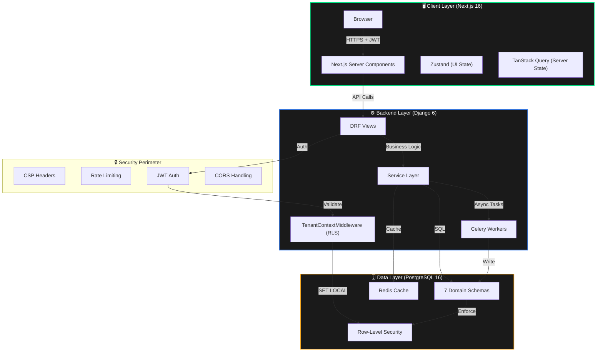
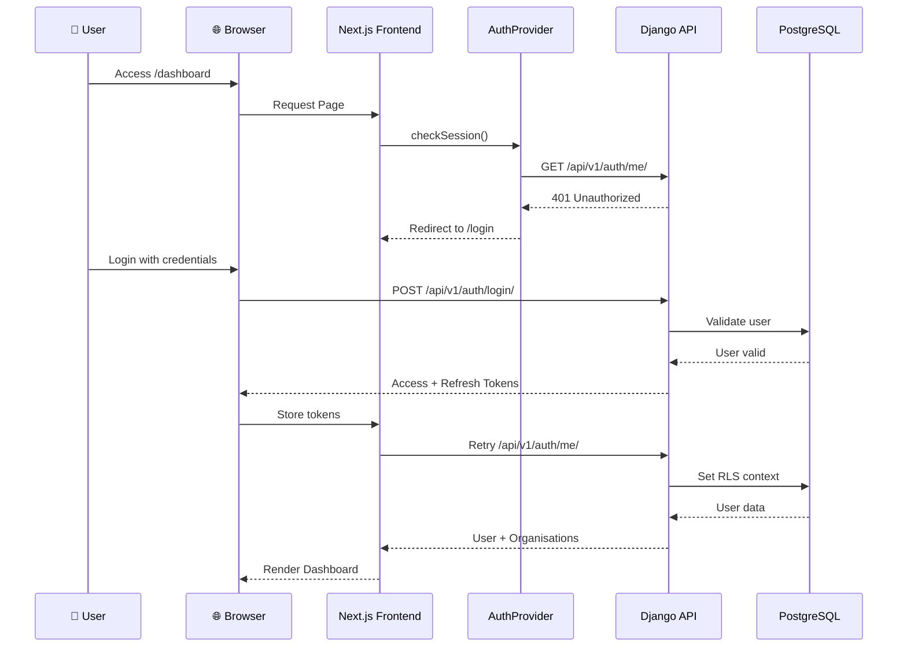
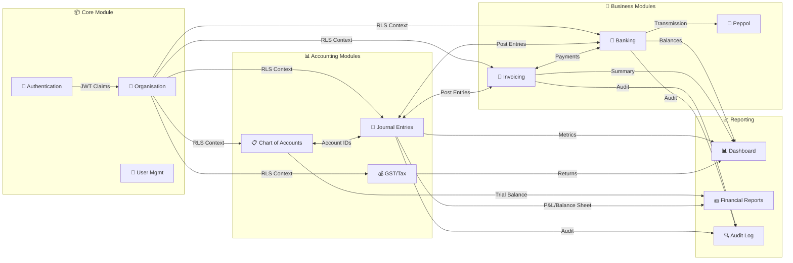

# LedgerSG — Enterprise Accounting Platform for Singapore SMBs

[]()
[]()
[]()
[]()
[]()
[]()
[]()
[]()

**Production-Grade Double-Entry Accounting for Singapore SMBs**

SQL-First • Service-Oriented • RLS-Enforced • Illuminated Carbon UI • IRAS Compliant

> *Unlike traditional accounting software designed for human clicks, LedgerSG is designed for **AI agent automation** - making it the first accounting platform built for the AI-first era.*

---

## 📋 Table of Contents

- [🎯 Project Overview](#-project-overview)
- [✨ Key Features](#-key-features)
- [📊 Current Status](#-current-status)
- [🧪 Test Suites & Execution](#-test-suites--execution)
- [🏗 System Architecture](#-system-architecture)
- [📁 Project Structure](#-project-structure)
- [💻 Technology Stack](#-technology-stack)
- [🚀 Quick Start](#-quick-start)
- [⚙️ Configuration](#️-configuration)
- [🔐 Security Posture](#-security-posture)
- [📜 Compliance](#-compliance)
- [🐳 Deployment](#-deployment)
- [🔧 Troubleshooting](#-troubleshooting)
- [🤝 Contributing](#-contributing)
- [📚 Documentation](#-documentation)
- [📈 Roadmap](#-roadmap)
- [📄 License](#-license)

---

## 🎯 Project Overview

**LedgerSG** is a high-integrity, double-entry accounting platform purpose-built for Singapore small and medium businesses (SMBs). It transforms IRAS 2026 compliance from a regulatory burden into a seamless, automated experience while delivering a distinctive **"Illuminated Carbon"** neo-brutalist user interface.

### Core Mission

> Transform IRAS compliance from a burden into a seamless, automated experience while delivering a distinctive, anti-generic user interface that makes financial data approachable yet authoritative.

### Target Audience

- Singapore SMBs (Sole Proprietorships, Partnerships, Pte Ltd)
- Accounting Firms managing multiple client organisations
- GST-Registered Businesses requiring F5 return automation
- Non-GST Businesses tracking threshold compliance

### Key Differentiators

| Feature | LedgerSG | Generic Solutions |
|---------|----------|-------------------|
| IRAS Compliance | ✅ Native (GST F5, InvoiceNow, BCRS) | ⚠️ Add-ons required |
| Database Security | ✅ PostgreSQL RLS at schema level | ⚠️ Application-layer only |
| Financial Precision | ✅ NUMERIC(19,4), no floats | ⚠️ Often uses floats |
| Multi-Tenancy | ✅ Database-enforced isolation | ⚠️ Shared tables |
| Audit Trail | ✅ Immutable 5-year retention | ⚠️ Configurable |
| UI Design | ✅ Distinctive "Illuminated Carbon" | ❌ Generic templates |

---

## ✨ Key Features

### Compliance Features

| Feature | GST-Registered | Non-Registered | Status |
|---------|----------------|----------------|--------|
| Standard-rated (SR 9%) invoicing | ✅ | ❌ (OS only) | ✅ Complete |
| Zero-rated (ZR) export invoicing | ✅ | ❌ | ✅ Complete |
| Tax Invoice label (IRAS Reg 11) | ✅ | ❌ | ✅ Complete |
| GST Registration Number on invoices | ✅ | ❌ | ✅ Complete |
| Input tax claim tracking | ✅ | ❌ | ✅ Complete |
| GST F5 return auto-generation | ✅ | ❌ | ✅ Complete |
| GST threshold monitoring ($1M) | ❌ | ✅ (critical) | ✅ Complete |
| InvoiceNow/Peppol transmission | ✅ (mandatory) | Optional | ✅ Complete (Phases 1-4) |
| BCRS deposit handling | ✅ | ✅ | ✅ Complete |
| 5-year document retention | ✅ | ✅ | ✅ Complete |

### Technical Features

- **Double-Entry Integrity** — Every transaction produces balanced debits/credits enforced at database level
- **NUMERIC(19,4) Monetary Precision** — No floating-point arithmetic; all amounts stored as DECIMAL in PostgreSQL (capacity above the S$1M GST registration threshold — schema v1.1.0)
- **Real-Time GST Calculation** — Client-side preview with Decimal.js, server-side authoritative calculation
- **Immutable Audit Trail** — All financial mutations logged with before/after values, user, timestamp, IP
- **PDF Document Generation** — IRAS-compliant tax invoices via WeasyPrint 70.0
- **Email Delivery Service** — Asynchronous invoice distribution with attachments via Celery
- **WCAG AAA Accessibility** — Screen reader support, keyboard navigation, reduced motion respect
- **Multi-Tenant Isolation** — PostgreSQL Row-Level Security (RLS) with session variables

---

## 📊 Current Status

| Component | Version | Status | Key Metrics |
|-----------|---------|--------|-------------|
| **Frontend** | v0.3.7 | ✅ Production Ready | 16 pages, **642 unit tests + 41 e2e** (11 always + 30 backend-gated; green on the first run of a fresh DB — the P20 bootstrap fix), typecheck clean, whole-tree eslint 0 errors, WCAG axe-clean login flow, cross-reload session persistence, real invoices list/detail + ledger + settings pages (P5/P6), working void-reason dialog + real error messages + PDF/InvoiceNow actions (P7), real reports page (statements, GST F5, aged AR/AP) + real quotes pages with convert flow (P8), organisation creation + the full payment workflow (bank accounts, contact picking, allocations, import, reconciliation, corrections) + a truthful dashboard (P9), registration + contacts management + the invoice-form contact picker + the full GST F5 lifecycle + bank-account edit/deactivate + fiscal open + change password + InvoiceNow settings (P10), the truthful edit dialog prefill + F5 box labels + dashboard GST/chart/prefix truth + permission-gated row actions + dev-only CSP unsafe (P11), the mobile-nav overlay a11y floor (P12), the closed-drawer visibility fix + X hit-target fix + axe-scanned overlay (P13), single-flight token refresh (P15), the nonce-CSP proxy + mobile-nav probe green (P16), the `--color-success` token + unsaved-changes guard + org-selector Radix menu contract + shared UEN schema + lint-error zero (P17), the contrast-pairing/token gates + the genuinely-shared uenSchema + nested-Escape fix + tw-animate-css restore (P18), the Radix-ified banking modals + the keyboard-operable transaction row + the WAI-ARIA ContactPicker combobox + the in-app unsaved-work route guard (P19), the named Notes/Terms fields + the named back links + the combobox blur dismissal + the timezone-safe dates + the raised coverage ratchet (P20), the banking a11y batch (the Reference name, the keyboard-reachable CSV import, the unique dialog ids, the loader live regions, the payment-card keyboard contract, the reconcile aria-pressed) + the timezone-safe date helpers + the visible-label ContactPicker (P21), the mobile-nav drawer-slide transition truth (the v4 standalone `translate` property pinned by its own compiled-CSS gate + the vitest critical-advisory closure at 4.1.12) (P23) |
| **Backend** | v0.6.6 | ✅ Suite Fully Green | 90+ endpoints, **969 tests passing** (0 failed), SQL-First, RLS transaction-scoped, HttpOnly refresh-cookie auth, real InvoiceNow wiring + accounting truth, per-status transition permissions + active custom exception handler (P7), real financial reports (TB/P&L/BS with retained earnings), aged AR/AP endpoint, quote lifecycle with persisted conversion links + QT numbering (P8), InvoiceNow invoice-only gate, nullable-PayNow bank-account contract, as-at-bounded aged reports, seeded account_type backfill + is_bank filter (P9), GST F5 review/amend + fiscal-period open + UEN uniqueness + rate-limit 429 truth + org-create duplicate-UEN 400s (P10), credit notes posting reversed GL entries + netting in F5, production settings that boot (builtin Redis cache, LOG_DIR knob), typed org-settings PATCH, routing-layer UUID 404s, audit-trail request context + LOGIN/LOGOUT emission (P11), FILED immutability + the GST period lock (P14), serializer contract fixes (P16), the concurrency guards (double-reversal / double-void / double-reconcile refused under row locks) + the 400-contract sweep + the Celery tenant context + the admin/STORAGES gates (P17), the statutory-record locks (generate/review F5) + the unallocate/unreconcile/convert/credit-cap row locks + the header/archived posting gate + the full Celery tenant-context coverage + the email status gate (P18), the remove_line lock + repair + the unallocate lock re-order + the archive cache bypass + the create_entry account locks + the status-task full context wrap + the uuid route islands + the CSV caps (P19), the void/transition/allocate lock completion + the CSV savepoint + magnitude bound + the posting-side cache invalidation (P20), the list-envelope unification ({results, count} everywhere — the prerequisite for pagination) + the InvoiceNow evidence stamp + the on-commit cache truth + the bank-account default-flag locks + the ValidateBalance typed-400 body (P21) |
| **Database** | v1.2.2 | ✅ Complete | 7 schemas + token blacklist, **RLS complete on every tenant table (§17)**, 29 domain tables + 1 view + §15c Django framework tables (incl. the ENABLE_ADMIN opt-in set), **NUMERIC(19,4) money** |
| **Accounting Engine** | v1.0.0 | ✅ Verified | 3/3 E2E Workflows (Lakshmi, ABC, Meridian) |
| **Banking UI** | v1.3.0 | ✅ Phase 5.5 Complete | 73 TDD tests, all 3 tabs live, reconciliation |
| **Dashboard** | v1.1.0 | ✅ Phase 4 Complete | 36 TDD tests, Redis caching; payables include PARTIALLY_PAID bills (P7/F-9) |
| **InvoiceNow** | v0.6.0 | ✅ Real transmission path (P5/C-2) | send-invoicenow creates a real transmission log + queues the Celery task; status reports real log rows; retention-safe cleanup (never deletes DELIVERED/REJECTED); the detail page exposes Send-via-InvoiceNow + status badge (P7) |
| **Security** | v1.3.0 | ✅ P0 Hardened + P4 Cookie Auth + P7 API gates | Token rotation + blacklist, SECRET_KEY gate, rate limiting default-on, HttpOnly refresh cookie + `session_hint` evidence gate, per-status document permissions, manager-gated settings PATCHes, typed query params (400 not 500) |
| **Overall** | — | 🟢 **P0–P23 Remediated; all gates green** | See `docs/REMEDIATION_2026-11-21_REPORT.md`, `_P1…_P9_REPORT.md`, `docs/REMEDIATION_2026-11-22_P10_REPORT.md`, `docs/REMEDIATION_2026-11-23_P11_REPORT.md`, `docs/REMEDIATION_2026-11-23_P12_REPORT.md`, `docs/REMEDIATION_2026-11-24_P13_REPORT.md` and `docs/ledgersg-audit-report.md` |

### Latest Milestone

#### 🎉 P23 Sprint: The Mobile-Nav Drawer Slide Truth + The Vitest Advisory Closure — 2026-11-27 (session 44)

Source: `docs/REMEDIATION_PLAN_2026-11-27_P23.md` (validated against the codebase before execution — the transition token compile-proven live; every fix TDD — RED first). No schema changes (v1.2.2 carries forward); no backend code changes (the P21 suite re-verified green on a fresh clone).

- ✅ **The drawer-slide truth (the mobile-nav Tailwind v4 bug, compile- and live-proven)**: Tailwind v4 renders `translate-x-*` through the **standalone `translate` CSS property** — the aside's `transition-[transform,visibility]` omitted it, so the 300ms slide never interpolated (the drawer snapped open/closed while every functional probe stayed green; the exact Trap 5(b) class in `docs/Tailwind-V4-Validation-Report.md`). Fixed to `transition-[transform,translate,visibility]`; the live agent-browser probe now reads `transitionProperty: "transform, translate, visibility"` and samples 16 intermediate translate values mid-flight
- ✅ **The animation-contract gate**: a new vitest spec (`shell-drawer-transition.test.tsx`) pins the compiled transition token + the positioning contract, and a new e2e spec (`P23/FE-M1`) asserts the computed `transition-property` in a real browser — the compiled-CSS gate the 13 prior mobile-nav settlements lacked
- ✅ **The vitest advisory closure**: `vitest` + `@vitest/coverage-v8` bumped ^4.0.18 → **^4.1.12** (the fixed 4.x line, a minor bump inside the caret range) — **both critical advisories closed** (GHSA-82fw-gwwq-j7x9 + GHSA-qxg6-89mg-rqv8; 20 → 17 findings, all remaining dev-tier, the production set clean)
- ✅ **The gate**: backend **969P/0F/5S** (re-verified) · vitest **642/642 (76 files)** · coverage green at the ratchet · tsc 0 · eslint **0E/0W** · live e2e **41/41** · rls_smoke 13/13 · mobile-nav 17/17 (fifteenth settlement — with the slide animating) · prod-CSP 5/5 · npm audit **0 critical** · 8 DOM-verified screenshots (128→136-143, incl. the drawer captured mid-slide)

#### 🎉 P21 Sprint: The List-Envelope Unification, the InvoiceNow Evidence Stamp, the Cache-Commit Truth & the Banking A11y Batch — 2026-11-27 (session 42)

Source: `docs/REMEDIATION_PLAN_2026-11-27_P21.md` (validated against the codebase before execution; every fix TDD — RED first). No schema changes (v1.2.2 carries forward).

- ✅ **The list-envelope unification (the deferred register's big-ticket item)**: every LIST endpoint now returns `{results, count}` — the 7 non-conforming sites (the orgs list, fiscal years, the bare-array `/auth/organisations/`, the journal trial balance + entry types, the IRAS tax-code info, the GST return-periods POST) unified; reports keep `{data: {...}}` (*lists → results, reports → data*); the frontend consumers + the e2e helpers + the bootstrap script migrated in the same commit; the prerequisite for list **pagination** (still deferred, now unblocked); the VACUOUS RLS isolation assert fixed (`test_rls_isolation.py` read `.get("data", [])` against a `{results}` endpoint — the assertion always passed)
- ✅ **The InvoiceNow evidence stamp**: `invoicenow_sent_at` is written on a DELIVERED Peppol transmission (nothing ever wrote it — the void/unallocate "restore to SENT" branch was dead code)
- ✅ **The cache-commit truth**: the dashboard + account-balance cache invalidations moved to `transaction.on_commit` (a delete inside the transaction re-seeds the stale value in the delete→commit window); void_document + manual journal entries now invalidate the dashboard cache too (the P5/H-3 completion)
- ✅ **The bank-account default-flag locking**: `set_default`/`update`/`deactivate` row-locked with scoped `update_fields` saves (two concurrent set_defaults can no longer leave two defaults; the full-row save no longer clobbers concurrent `opening_balance` edits)
- ✅ **The ValidateBalance typed-400 body**: malformed `lines` (non-numeric debit/credit, dict/string bodies) are clean 400s (was AttributeError/InvalidOperation 500s)
- ✅ **The banking a11y batch (the two Highs + the Mediums)**: the Make-Payment Reference input's accessible name; the keyboard-reachable CSV import (`sr-only`, not `hidden`); the import dialog's unique ids; the loader live regions on every remaining surface; the payment-card keyboard contract; the reconcile selection's `aria-pressed`; the GST year read lexically + local-today defaults (the FE-M7 class completion); the visible-label ContactPicker; the dead `accent-primary` token fixed
- ✅ **The gate**: backend **969P/0F/5S** (+19) · vitest **641/641** (+14) · tsc 0 · eslint **0 errors / 0 warnings** · coverage green at the ratchet · live e2e 40/40 · rls_smoke 13/13 · mobile-nav 17/17 (thirteenth settlement) · prod-CSP 5/5

#### 🎉 P18 Sprint: Statutory-Record Locking, the Contrast Debt, the Celery Coverage Completion & the Fresh-Host Truth — 2026-11-27 (session 36)

Source: `docs/REMEDIATION_PLAN_2026-11-27_P18.md` (validated against the codebase before execution; every fix TDD — RED first).

- ✅ **Statutory-record locking (the High)**: `generate_f5`/`review_return` now take the same row lock `file_return` carries — a concurrent recompute can no longer regress a FILED return to COMPUTED while `filed_at` stays populated (the P14/C-2 regression shape, reopened through a race)
- ✅ **The concurrency completion**: `unallocate`/`unreconcile` locked (same lock order as their siblings), `convert_quote_to_invoice` locked (double-convert refused), `add_line`'s line-number race closed + typed 400 on the residual constraint hit, the credit-note cumulative cap locked, header/archived accounts refused at `create_entry` (the TB/ledger divergence closed), `archive_account` locked
- ✅ **The Celery coverage completion**: the three remaining Peppol task bodies open the RLS tenant context (org passed explicitly — the RLS-scoped log row cannot be read to learn it); the production-only `on_commit` dispatch branch now test-covered; deleted-org/document tasks classify as terminal instead of retry-to-death
- ✅ **The contrast debt (the frontend High)**: the three `bg-success text-white` badges (1.33:1!) fixed to `text-void` (15.27:1), the `bg-alert` trio likewise, `--color-text-muted` raised to AA, the header's AAA claim corrected — all pinned by new pairing/ratio regression gates
- ✅ **The real Tailwind v4 fix**: `tw-animate-css` imported — the `animate-in`/`fade-in-0`/`zoom-in-95`/`slide-in-*` family on the Radix primitives compiled to NOTHING in v4 (the v3 plugin's vocabulary silently dead); a compiled-CSS gate now pins the utilities
- ✅ **The genuinely-shared uenSchema**: the invoice customer field normalizes like the org form and the backend (lowercase UENs no longer false-rejected); the org form validates through the shared schema (one message source)
- ✅ **Schema v1.2.2 (§15c completion)**: `django_session` + `django_admin_log` — the `ENABLE_ADMIN` opt-in no longer 500s on a schema-only host
- ✅ **The gate**: backend **914P/0F/5S** (+32) · vitest **601/601** (+19) · tsc 0 · eslint 0 errors / 5 parity warnings · build:server green · CI gains the no-backend e2e job

#### P20 Remediation (2026-11-27, session 40) — the void/transition lock completion, the CSV transaction poisoning, the e2e first-run truth & the test-config ratchet

Source: `docs/REMEDIATION_PLAN_2026-11-27_P20.md` (validated against the codebase before execution; every fix TDD — RED first).

- ✅ **The locking completion (the Highs)**: `void()` locks its affected documents (sorted pre-lock — a concurrently-committed allocation is no longer silently lost from `amount_paid`); `transition_status()` locks + re-validates post-lock + `update_fields` (no stale status/totals writes over a concurrent approval); `allocate()` pre-locks its documents in sorted order (the AB-BA class closed)
- ✅ **The CSV transaction poisoning (the High)**: the per-row savepoint + the `1E15` magnitude bound — one poison row (a NUMERIC(19,4) overflow) is now a typed row error in `errors[]` while the surrounding rows import (never an abort-everything 500)
- ✅ **The e2e first-run truth (the cross-cutting High)**: the banking helper is contact-self-sufficient and the one-command §9 bootstrap script ships (a fresh DB's first full run is green — the red-run-1/green-run-2 flake closed by construction); the posting-side balance-cache invalidation; the a11y Highs (the invoice-form Notes/Terms names, the named back links); the ContactPicker blur dismissal; the timezone-safe date formatter; the one-h1-per-page shell; the loading live regions
- ✅ **The test-config ratchet (the owner's named task)**: the coverage surface expanded to `src/app/**` + `src/providers/**` with per-glob floors, the whole-suite floor RAISED 62/51/52/63 → 71/60/68/71; playwright gained `retain-on-failure` traces + the en-SG/Asia-Singapore locale/timezone pins; `test:all` runs the coverage
- ✅ **The gate**: backend **950P/0F/5S** (+13) · vitest **627/627** (+8) · tsc 0 · eslint **0 errors / 0 warnings** · coverage green at the RAISED ratchet · live e2e 40/40 (green on the FIRST run of a fresh DB) · rls_smoke 13/13 · mobile-nav 17/17 (eleventh settlement) · prod-CSP 5/5

#### P19 Remediation (2026-11-27, session 38) — the remove_line truth gap, the modal semantics debt, the ContactPicker & the route guard

- ✅ **The gate**: backend **937P/0F/5S** (+23) · vitest **619/619** (+18) · tsc 0 · eslint **0 errors / 0 warnings** (the 5 parity warnings cleared) · live e2e 40/40 · rls_smoke 13/13 · mobile-nav 17/17 (ninth settlement) · prod-CSP 5/5

#### P17 Sprint: Concurrency Truth, the 400-Contract Sweep & the Celery Tenant Context — 2026-11-27 (session 34)

Source: `docs/REMEDIATION_PLAN_2026-11-27_P17.md` (validated against the codebase before execution; every fix TDD — RED first).

- ✅ **Concurrency guards (the Highs)**: double journal-entry reversals refused (typed 400, row lock + re-check), double payment void refused under `select_for_update`, reconcile double-match refused (typed 400) — the three money-mutation races closed
- ✅ **The Celery tenant context (H-3)**: tasks dispatched `on_commit` (never inside the request transaction) and the worker wraps each task body in the RLS tenant context (`app.current_org_id` SET LOCAL) — eager mode stays bit-identical for dev/test
- ✅ **The 400-contract sweep**: typed GST box parsing (None/dict/"garbage" → 400), bulk-allocation UUID field errors, UEN normalize-then-validate on org PATCH (case-dodge duplicates refused), tax-rate range on update, exchange_rate stored at its true 6-dp wire precision
- ✅ **Settings/ops gates**: `/admin/` 404s outside DEBUG (settings-gate tested), the Django 6 `STORAGES` manifest migration (WhiteNoise compressed-manifest storage actually active), `select_related` on the three list services (O(1) FK queries, query-count gated), no negative-membership cache poisoning
- ✅ **Frontend contract batch**: the `--color-success` token (14 previously-dead class usages now compile), the unsaved-changes `beforeunload` guard wired, the org-selector Radix menu contract (aria + Escape + outside-click + arrow keys), the shared `uenSchema` across all three surfaces, redirect-carry on refresh failure, the four dead CSP origins dropped, whole-tree eslint **0 errors**
- ✅ **Schema v1.2.1 (§15c)**: the Django framework tables, SQL-First — the fresh-host pytest gap (transactional teardowns) closed
- ✅ **The gate**: backend **882P/0F/5S** (+22) · vitest **582/582** (+28) · tsc 0 · eslint 0 errors (5 warnings, documented parity) · build:server green · mobile-nav probe 17/17 (no Tailwind v4 bug — re-settled on the remediated tree)

#### P16 Sprint: CSP Nonce, the Proxy Restore & Serializer Contract Fixes — 2026-11-26 (session 32)

- ✅ **The per-request nonce CSP** (`src/proxy.ts` + `src/lib/csp.ts`): production serves `script-src 'nonce-…'`, no `unsafe-inline`; the production-CSP smoke (5/5) and the vitest proxy-orchestration tests pin it
- ✅ **The middleware restore** (Next 16 `middleware`→`proxy` rename): static security headers consolidated in `next.config.ts headers()`, CSP owned by the proxy
- ✅ **Serializer contract fixes** + the mobile-nav live probe (17/17) re-settled; session 33 archived the raw transcript

#### 🎉 P15 Sprint: Tree Repair, P14 Completion & the Runtime-Role Gate — 2026-11-26 (session 30)

Source: `docs/REMEDIATION_PLAN_2026-11-26_P15.md` (validated against the codebase before execution). The interrupted session-29 had committed its P14 work to wrong paths (`2bcb43f0` — the Payment model was destroyed by a serializer overwrite; the backend could not boot). This sprint repaired the tree and completed the P14 remediation end to end:

- ✅ **Tree repair**: the Payment model restored, the stranded C-1/C-2/H-05b/H-3 fixes relocated to their canonical homes, the backend boots
- ✅ **Statutory truth (P14)**: FILED/AMENDED returns immutable (409), the GST period lock (no back-posting into filed periods), credit notes require + cap against the original invoice, the GST-registration guard, the allocation cap + instalment statuses
- ✅ **RLS complete (schema v1.2.0 §17)**: all six unprotected tenant tables gated; `audit.log_change` pins its search_path; the audit trail is append-only
- ✅ **The runtime-role gate (C-1/H-7)**: the full onboarding path runs as the non-superuser `ledgersg_app` role — 13/13 smoke steps green, cross-org reads blocked, no-context reads fail closed
- ✅ **Input + PDPA hardening**: the line-item schema (400s not 500s), the honest ACRA/IRAS UEN+GST validators (both documented M-form lengths), NRIC PayNow masking, Viewer read-only, XXE-hardened XML parsing, tax-code dedupe
- ✅ **Security upgrades (H-8/H-9)**: Django 6.0.10, DRF 3.18.3, lxml 6.1.3, WeasyPrint 70, Next 16.4.6, zod 4.6.7 — **zero known advisories on both production dependency sets**; the Docker path generates a strong per-boot key
- ✅ **Frontend**: single-flight token refresh (the rotation race killed sessions mid-suite); the e2e bootstrap self-creates the F5 return on fresh databases

**Final gate (all executed):** backend **834P/0F/5S** · vitest **532/532** · tsc 0 · coverage green at both ratchets · eslint 9 · build:server green · e2e default 11P+29 gated · **live e2e:full 40P/0F/0S** · **rls_smoke 13/13 as `ledgersg_app`** · mobile-nav **17/17** (the navigation works; no Tailwind v4 bug exists — re-settled live)

#### P13 Sprint: Transactional Truth, Header Consolidation & the Typed Suite — 2026-11-24 (session 27)

Source: the post-P12 audit executed live (`docs/REMEDIATION_PLAN_2026-11-24_P13.md`) — all baselines reproduced (735P/5S, 518 vitest, eslint 45, live e2e 37P/0F with the P12 data-conditional skip now passing), the mobile nav + Tailwind v4 questions re-settled with an @layer-aware matched-rule trace, three parallel deep-audit agents (frontend / backend / docs-drift) + lead hand-verification of every Critical/High.

- ✅ **The sprint's focus re-verified**: the mobile nav works at 375/800/1280 and NO Tailwind v4 bug exists (the @layer-recursing rule trace re-proved only `.inline-flex` + the media-gated `.md:hidden` match; the v4 trap log swept — the nav's space-y children carry no explicit margins, so no double-margin violation)
- ✅ **B-1 (Critical)**: the DRF exception handler's 500 fallback now marks the transaction for ROLLBACK — unhandled exceptions can no longer commit partial financial state (runtime-reproduced pre-fix: a register-halfway user COMMITTED behind the 500; post-fix: rolled back)
- ✅ **B-2 (High)**: the GST per-line rounding quantum fixed to the IRAS-mandated 2dp — `Decimal(1).scaleb(-rounding)` (sub-cent bases like 100.05 × 0.09 now yield 9.00, verified live; was the 3-dp 9.005)
- ✅ **H-1 (High)**: the dual header definitions consolidated — middleware deleted, its unique headers (COOP/CORP/COEP, upgrade-insecure-requests, the full Permissions-Policy) ported into `next.config.ts`, the deprecated X-XSS-Protection dropped; production no longer ships `'unsafe-eval' 'unsafe-inline'` (served-headers verified live; the Next 16 middleware→proxy deprecation warning is gone)
- ✅ **H-2/M-1 (mobile-nav edge states)**: the closed drawer is `invisible` below md (out of the tab order + a11y tree, animation-safe) and the header z-50 keeps the X toggle the real click target while the menu is open — both e2e-pinned with visibility + elementFromPoint assertions plus an axe scan of the open overlay
- ✅ **The backend contract batch**: typed ImmutabilityError (409 not 500), InvoiceNow missing-document 404s, atomic create_reversal, service/DB balance-tolerance alignment (0.0001), health-endpoint error hygiene, the timezone-aware date sweep (17 naive sites), settings copy-on-write completion (SIMPLE_JWT + DATABASES)
- ✅ **W-3/M-4 — the typed suite**: all 36 `no-explicit-any` cleared (35 test casts via the in-file `as unknown as ReturnType<typeof hook>` pattern + the one production `any` given the real `BankAccount` type) — eslint **45 → 9**; vitest gains per-glob coverage thresholds (`src/lib/**` at the measured floor); playwright gains `expect.timeout` + the axe/visibility/hit-target specs
- ✅ **The gate**: backend **750P/0F/5S** (+15 new tests, all RED first), frontend **530/530** (+12), typecheck 0, coverage green (whole-suite 63/51/52/62 + src/lib 73/52/74/71), build:server green, default e2e 11 + 29 gated, live e2e:full **40P/0F/0S** (40 specs), 8 pixel-verified screenshots (72–79, session-27 series)

#### P12 Sprint: Mobile-Nav Truth & A11y Floor — 2026-11-23 (session 25)

Source: the post-P11 audit executed live (`docs/REMEDIATION_PLAN_2026-11-23_P12.md`) — agent-browser at 375×812 / 800×1024 / 1280×800 against the running dev stack, computed-style rule traces on the nav DOM, the repo skills' failure taxonomies (`skills/nextjs16-tailwind4`, `skills/tailwind-patterns`, `skills/astro-7-patterns`).

- ✅ **The mobile navigation menu verified working end-to-end** (the sprint's focus): toggle/overlay/open/close/navigate/auto-close/desktop-sticky all pass live at every viewport; the CSS cascade traced rule-by-rule (only `.inline-flex` + the media-gated `.md:hidden` match — the suspicious `display:flex` reading was correct CSS flex-item blockification, not a Tailwind v4 bug; the v4 setup itself is clean: `@import "tailwindcss"` + `@theme`, no legacy config)
- ✅ **The overlay a11y floor** (A-1): Escape closes the open menu (live-verified: previously it stayed open), body scroll locks while open, focus moves into the sidebar on open and returns to the toggle on close, and Tab cycles within the sidebar while open — 7 vitest (RED: 6 failed for exactly these gaps) + 3 gated e2e specs
- ✅ **The lint-debt truth pass** (A-3): the full-repo register had drifted to 79 findings while parity was only checked on touched files; every mechanical class cleared (30 unused-vars, prefer-const, no-unescaped-entities, the CustomTooltip-in-render anti-pattern, the dead shell mounted gate) — **79 → 45**, remaining are the registered any-debt + mounted-gates + compiler-informationals
- ✅ **`data-scroll-behavior="smooth"`** on `<html>` (A-4): kills the Next.js 16 route-transition warning (verified gone live)
- ✅ **`API_CLI_Usage_Guide.md` re-verified live** (A-8): all 9 documented list envelopes + the journal mount + the login contract re-exercised against the running stack; credit-note reversal + current metrics documented; the session-persistence limitation rewritten to the Playwright storageState truth
- ✅ **The gate**: backend 735/0 (unchanged), frontend 518/518, typecheck clean, coverage green at the ratchet, build:server green, default e2e 11 green + 26 gated, live e2e **36P/1S/0F** (37 specs incl. the 3 new mobile-nav specs), eslint 79→45 with no new findings. Superseded by P13 (see the P13 milestone below): 750/530, e2e 40P/0F, eslint 9

#### 🎉 P11 Sprint: Accounting Truth & Config Honesty — 2026-11-23 (session 23)

Source: the post-P10 audit re-verified in source (`docs/REMEDIATION_PLAN_2026-11-23_P11.md`); every Critical/High hand-verified with line numbers and two runtime reproductions before planning; the live API gate then exercised the full accounting path end to end.

- ✅ **Credit notes post REVERSED GL entries** (C-1 — the Critical): `post_invoice` posted credit notes with invoice-direction entries — a credit note DEBITED the customer's AR instead of crediting it (the books overstated receivables on every credit note since the posting engine shipped). Direction now flips by document type; the F5 computation also nets credit-note boxes and stops counting quotes (H-3). Live-gate proof: invoice AR-debit 2725.00 vs credit note AR-CREDIT 817.50; F5 Box 1 = 3500.00 with 750.00 credit notes netting
- ✅ **Production settings boot** (C-2 — the Critical): production declared `django_redis` (a dependency production never installs) — every cache touch crashed the boot; plus `DEBUG=true, DEBUG_TOOLBAR=false` crashed dev startup (two gates disagreed on the knob). Production uses the builtin Redis backend; `LOG_DIR` is a settings/env knob with the file-handler path derived from it; debug_toolbar has ONE gate (`INSTALLED_APPS` — H-5)
- ✅ **The contacts edit dialog tells the truth** (H-1 + M-3/M-4): the dialog prefilled from the LIST row's serializer — uen/peppol_id/address/gst_reg_number rendered blank and an unconditional save ERASED the stored values with a success toast (Peppol ID loss breaks InvoiceNow). The dialog now prefills from the DETAIL endpoint, `gst_reg_number` is a declared PATCH field (previously silently dropped by DRF), and the search debounces (M-4)
- ✅ **The F5 boxes panel and dashboard GST tell the truth** (H-2/H-4 + M-1/M-7/M-11/L-2): the panel read box keys the backend never sent — every box rendered "—"; the dashboard's GST payable was hardcoded to 0.00 and the revenue chart NaN'd to 0 on "SGD x.xx" strings; six "S$ SGD" double prefixes fell. Box keys, the deadlines envelope, the REVIEWED deadline filter, raw-value chart inputs and single prefixes are all truthful now
- ✅ **Contract truths** (M-2/M-5/M-6): bank-account PATCH without an id is a 404 (was 500); the org-settings PATCH accepts choice fields and 400s garbage (entity_type/base_currency — was 500 on any PATCH because the serializer didn't exist); garbage path UUIDs 404 at the ROUTING layer (uuid converters — was ValueError 500)
- ✅ **The audit trail carries its context** (M-8): the trigger's INSERT never read the middleware's `app.client_ip/user_agent/request_path` — the columns stayed NULL on every row; LOGIN/LOGOUT existed in the CHECK vocabulary but no code ever emitted them. Both fixed
- ✅ **Config honesty** (M-9..M-14 + H-6/H-7 + M-15/M-16 + L-batch): coverage runs in CI (it never had — the "tests pass" step was misleading), dead CI steps removed, devDependencies split out of the production dependency list, `.gitignore` covers `uv.lock`, the Makefile tells the truth, the Docker path boots (pinned installs, gunicorn CMD, compose credentials, no-at-boot migrate), CSP unsafe-* directives are dev-only with `connect-src` from env, root debris (tracked logs, a broken symlink, stale scripts) removed, `date.today()` → `timezone.localdate()`, ledger reversals visible, the dead ValidationError branch removed, UEN TOCTOU hardening
- ✅ **The live gate**: the full accounting loop verified against the running servers — contact PATCH (gst_reg_number persists), invoice DRAFT→APPROVED (journal posted), credit note APPROVED (reversed journal), F5 computed (boxes net credit notes), dashboard GST payable = 315.00 matching F5 Box 8 — plus 7 content-verified screenshots (`docs/screenshots/59-65_*_session23.png`)
- ✅ **The gate**: backend 735/0, frontend 511/511, typecheck clean, coverage green at the ratchet, build:server green, default e2e 11 green + 23 gated, live e2e 33P/1S/0F


#### P10 Sprint: Self-Serve Loop & Compliance Truth — 2026-11-23 (session 20)

Source: the post-P9 audit re-verified in source (`docs/REMEDIATION_PLAN_2026-11-22_P10.md`); the live e2e gate then surfaced five more defects the mocked gates could not see (all fixed with regression tests).

- ✅ **The self-serve loop closes** (H-2 — the Critical): the login page's "Create account" link was a dead `href="#"` while `POST /auth/register/` existed with zero frontend consumers; the registration page ships (12-char password floor mirrored in markup) and routes org-less fresh accounts to the P9 org-creation page. The live gate then found the deeper bug: the auth-provider's mount-time session check treated the anonymous 401 an unauthenticated visitor on /register gets as session expiry and bounced them to /login — the form only ever worked by winning that race; public auth pages are exempt now
- ✅ **The invoice form picks real contacts** (H-1): every submission created a contact (repeat invoicing duplicated UEN-less customers and 409'd on repeat UENs); the Customer card is now a two-mode picker — select-existing (default, no contact row created) or explicit new-customer — with the wire contract e2e-asserted (picking issues zero createContact requests)
- ✅ **The GST F5 tab tells the whole truth** (H-3): the File button POSTed a return that was always DRAFT (compute was never wired) while the review/amend endpoints existed with zero callers; the tab ships the full lifecycle — create periods, compute the boxes, manager-gated review, file, amend, and the next-filing deadline banner from the real endpoint
- ✅ **Contacts are manageable** (M-5): full CRUD existed in the backend with zero UI — a wrong Peppol ID or email (required for InvoiceNow) could never be corrected in-app; the page ships with search, type filters, edit dialog, and deactivate
- ✅ **Bank accounts are correctable** (M-6) and **payment allocations visible** (M-7): per-row Edit (prefilled, immutable account number/currency) + deactivate with confirm; the payments list shows each payment's allocations with a toggle
- ✅ **Fiscal periods can be opened** (M-8), **passwords changeable** (M-9 — the profile card claimed a change endpoint existed; it didn't), **InvoiceNow configurable** (M-10 — the settings PATCH's error referenced a surface that didn't exist)
- ✅ **Contract truths** (M-1..M-4, L-batch): bank-account PATCH stores null/"" PayNow pairs and refuses dangling ones (create already did); `transition_status` VOID without a user fails closed with a clean 400; the chosen organisation survives a reload (set-default-org wired); transmission errors read the real keys; quote back-links, dead Load-more buttons, the allocation query gate, per-row import errors, and payment-filter labels all tell the truth (L-1..L-5)
- ✅ **Build-mode truth** (M-12/M-13): the static-export mode is retired (it cannot support API-driven detail routes — `generateStaticParams` cannot enumerate live IDs); standalone is the only build; the vitest coverage gate sits at the honest measured floor (the old 85% thresholds had never passed)
- ✅ **The live gate's own findings, all fixed with regression tests**: django-ratelimit's blocked requests surfaced as a raw 403 "You do not have permission…" (a PermissionDenied subclass falling through DRF's handler — clients could not tell a rate limit from an authz failure; now the documented 429 contract), the dev login per-user budget blocked the e2e tail, `development.py` mutated the shared settings lists in place (importing it under other settings crashed a 79-test cascade — copy-on-write now), and organisation UEN collisions were unhandled IntegrityError 500s (clean 400s on create and both PATCH paths)
- ✅ **The CI record is corrected honestly** (M-11): the "corrupted trigger" finding was a tool-display artifact — the workflow file was never corrupt; the corrective commit documents it
- ✅ **The gate**: backend 687/0, frontend 505/505, typecheck clean, coverage green at the honest ratchet, build:server green, default e2e 11 green + 20 gated, and the live e2e suite 30/30 green two consecutive runs against the live stack (register → org create → dashboard included)

#### P9 Sprint: Onboarding & Banking Truth — 2026-11-22 (session 18)

Source: the post-P8 audit re-verified in source (`docs/REMEDIATION_PLAN_2026-11-22_P9.md`); three live e2e iterations surfaced contract breaks the mocked unit gates could not see.

- ✅ **Organisation creation ships** (O-1 — the Critical): registration created a user with no organisation and the dashboard's only CTA linked to a route that did not exist — a self-serve user hit a 404 and could not use the product at all. The page ships at the route the CTA already targets (name/UEN/entity type/GST toggle; the backend seeds the chart, fiscal year, roles, and tax codes)
- ✅ **The payment workflow is real end to end** (B-1..B-3b): statement import sends real multipart (the old `JSON.stringify(FormData)` sent `"{}"` — no bank transaction could ever enter the app); reconciliation matches render (the `{results, count}` envelope had no `.length` — "No matching payments found" every time); payment forms pick real contacts through a searchable picker (the Customer field was a raw UUID text input); allocations settle invoices (the backend accepted inline allocations since P5 — no UI ever sent them); the invoice detail's Record Payment deep-links into Banking prefilled
- ✅ **Bank account management + corrections** (B-4..B-6): the Add Account buttons were dead (no form existed); the bank-account dialog ships (zod-validated, bank-type GL picker); payment Void and transaction Unreconcile give the P5/P6 void-with-reversal engine its first UI
- ✅ **The dashboard tells the truth** (D-2..D-4): the GST F5 chart's invented Box 1/2 bars and default output/input figures are gone (only the real Net GST renders); the static "+8.2%/-2.4%/+12.5%/On track" trend claims are removed (not backfilled with guesses); the dead `href="#"` CTAs route to the real reports page
- ✅ **The invoices list shows invoices** (C-2): the page now filters `type=SALES_INVOICE` — quotes and bills no longer render as invoices with fabricated Amount Due states; non-invoice types are labelled if they ever leak through
- ✅ **Seeded accounts are filterable** (C-4 + follow-ups): the org seed now backfills the `account_type` varchar (the column the API filter reads was NULL on every seeded account — the invoice form's account dropdown was empty on fresh orgs), and the bank accounts (children of the 1000 header) are reachable via the `is_bank` filter (the top-level-only list default hid them)
- ✅ **The quote-conversion envelope is pinned and read** (C-1): the endpoint nests the invoice under `invoice` but the hook read it flat — every conversion toasted "Invoice undefined" and routed to `/invoices/undefined`; `status_history` synthesizes from the model's timestamps (C-5); the CONVERTED badge gates on the persisted link, not the status (C-6)
- ✅ **Hardening riders** (B-7/S-1/S-4): the suggest-matches `?tolerance=` NameError 500 and the documents-list garbage-date 500 are 400s; InvoiceNow transmits invoices only (an APPROVED quote could be delivered as a UBL Invoice into a recipient's AP pipeline by any member — type gate + `CanCreateInvoices`); the aged report honours its as-at date (D-1); the stale root `requirements.txt` (a sandbox pip-freeze contradicting the backend pins) is retired
- ✅ **Session + Peppol posture** (S-2/S-3): a transport fault no longer bounces a logged-in user to /login (only 401/403 clear the session); XSD validation fails CLOSED when the schema cannot load (it previously validated everything)
- ✅ **The live workflow e2e spec ships** (the gate): bank account dialog → Record Payment deep link + contact picker + allocation → multipart import → rendered 100% match → reconcile → invoice Paid — 26/26 e2e green against the live stack

#### P8 Sprint: Reporting Truth & Quote Lifecycle — 2026-11-22 (session 16)

Source: the post-P7 audit re-verified in source (`docs/REMEDIATION_PLAN_2026-11-22_P8.md`).

- ✅ **GST registration is manager-gated again** (G-1): the P7/F-10 `get_permissions()` refactor was applied to a view whose mutating verbs are POST/DELETE — any member could register/deregister the org for GST
- ✅ **The void contract is aligned end to end** (G-3/G-5/G-8): `void_document` accepts exactly the statuses `STATUS_TRANSITIONS` advertises (an OVERDUE invoice could be voided through NO endpoint); PAID is refused with credit-note guidance; payment allocations must be released before a void; the generic `/status/` endpoint requires a reason like the dedicated `/void/`; the Void and InvoiceNow buttons gate on the real backend contract
- ✅ **Send-email delivers cc/bcc** (G-6): both were validated since P7 but silently dropped; the phantom `message` field is gone from the contract; PDF download errors surface the backend envelope (G-7)
- ✅ **Financial reports are real** (R-2/R-3): the trial-balance stub `{data:{}}` delegates to the journal service; the balance sheet folds retained earnings and ties out; P&L and BS expose per-account lines; custom accounts carry their `account_type_ref` so API-created revenue is visible in the statements (R-4)
- ✅ **Aged receivables & payables endpoint** (R-5): per-contact rows bucketed current/1-30/31-60/61-90/90+, semantics mirroring the dashboard
- ✅ **The reports page is real** (R-7/R-8): tabbed statements (TB/P&L/BS/GST F5/aged) with compute + file actions; the two dormant hooks pointing at 404 endpoints are deleted
- ✅ **Quotes are real** (Q-1..Q-4): conversion persists `related_document` (the link was silently discarded); prefixes match the seeded sequences (QT-/BILL-); the quotes list/new/detail pages ship with the convert flow; quotations get their own PDF template (no more TAX INVOICE labelling on quotes)
- ✅ **Fiscal-year close requires closed periods** (S-1); the dead core-dashboard duplicate is retired (S-3); settings edits survive background refetches and org renames propagate to the sidebar without a reload (S-2)
- ✅ Query-param hardening completed (G-2): the P7 sweep's misses (banking UUID filters, ledger dates, negative limits) are 400s


#### 🎉 P7 Sprint: API Truth & Permission Hardening — 2026-11-22 (session 14)

Source: the post-P6 audit re-verified in source (`docs/REMEDIATION_PLAN_2026-11-22_P7.md`).

- ✅ **The Void button works** (F-1): the detail page opened a REQUIRED-reason dialog (Shadcn/Radix) — the pre-P7 page sent `reason: ""` and every void from the UI 400'd; void also invalidates the ledger cache now
- ✅ **Status-transition authorization** (F-2): the `/status/` endpoint compared against the non-existent `"VOIDED"` literal, so the `CanVoidInvoices` check never fired — any member could void any document; the status is now a ChoiceField, every transition is permission-gated, and PAID/PARTIALLY_PAID are reserved to the allocation service
- ✅ **The custom exception handler is actually active** (F-19): `REST_FRAMEWORK` used the wrong DRF key (`DEFAULT_EXCEPTION_HANDLER` — DRF's key is `EXCEPTION_HANDLER`), so every in-view `LedgerSGException` surfaced as an unhandled 500 instead of its mapped status code; fixed + posture-gated
- ✅ **Fiscal endpoints routed** (F-4): `fiscal-periods/` and the two close endpoints lived only in the shadowed `apps/core/urls.py` module — the frontend's calls 404'd; routes moved into the active package, close views manager-gated + timezone-aware
- ✅ **Org create no longer crashes on its own advertised field** (F-3): the create serializer's phantom `address` (no such model field) produced a TypeError 500; the PATCH twin was fixed in P6/F-10
- ✅ **Send-invoice recipients** (F-6): the frontend sent `to` as a string; the email task requires a list and crashed silently while the UI toasted success — normalized + email-validated on both sides
- ✅ **Real error messages** (F-7): the api-client now reads the backend error envelope (`{error:{message}}`) and DRF field errors — business-rule messages finally reach the user (this is what hid the void defect)
- ✅ **Outstanding payables include PARTIALLY_PAID bills** (F-9): the status filter made partially-paid bills vanish from payables entirely
- ✅ **Settings PATCHes typed + manager-gated** (F-10): invalid values were 500s (raw setattr onto models) and any member could flip InvoiceNow/base currency
- ✅ **Malformed query params are 400s** (F-11): shared parse helpers replace the bare `strptime`/`UUID`/`int` calls at the audited sites (banking tolerance probe included)
- ✅ **Truthful no-org states** (F-12) + org-derived GST flag (F-14) + shell fixes (F-17); **dead code removed** (F-13): the mock-era edit route (created duplicate contacts if reached by URL), `useUpdateInvoice`, the legacy `lib/server/api-client.ts` — while `useInvoicePDF` + InvoiceNow send/status are wired as real actions on the detail page
- ✅ **Permission classes** (F-15): dashboard metrics/alerts require `can_view_reports`; the org-scoped GST views carry `IsOrgMember`
- ✅ **Bank-account GL-account truth fails closed at every seam** (F-5): the service raised a clean ValidationError instead of the database's raw IntegrityError

#### 🎉 P6 Sprint: C-5 Completion & Payment Posting Integrity — 2026-11-22 (session 12)

Source: the post-P5 audit re-verified in source (`docs/REMEDIATION_PLAN_2026-11-22_P6.md`).

- ✅ **PARTIALLY_PAID is no longer a dead end** (F-4): `allocate()` accepts second allocations — P5/H-1 persisted the status but the guard was never widened
- ✅ **Exact payment control accounts** (F-5/F-6): the payment journal entry resolves AR/AP through the P5/H-4 fail-closed resolver (1200/2100) instead of a broad `Q(account_type=…).first()` that could post AR to 1010 Cash on Hand; `create_contact` assigns default AR/AP control accounts so the normal path never depends on the fallback
- ✅ **unallocate() recomputes** (F-7): `amount_paid`/status/`amount_due` stay truthful after an allocation is removed (P5/H-1 covered allocate/void only)
- ✅ **Organisation address is updatable** (F-10): both update allowlists forwarded a phantom `address` key the model does not have while filtering out the real fields (`address_line_1/2`, `city`, `postal_code`, `country`)
- ✅ **Invoice detail truth** (F-11): the detail serializer exposes `amount_paid`/`amount_due`; the detail page is real end-to-end (status, lines, totals, payment state, approve/void/send mutations, `await params`)
- ✅ **Real ledger page** (C-5): new flat line-level `journal-entries/ledger/` endpoint + `useLedger` + props-driven table — one row per journal line
- ✅ **Real settings page** (C-5): controlled inputs over the real organisation, GST register/deregister wiring (seeds the GST control accounts)
- ✅ **e2e-friendly rate budgets as settings** (E-1): `REFRESH_RATELIMIT_IP` knob (production 20/min unchanged), development raises refresh + DRF budgets; the testing-settings REST_FRAMEWORK override made copy-on-write (it corrupted the shared base dict)
- ✅ **C-5 closed**: every dashboard page now renders real backend data (mock fixtures deleted)

#### 🎉 P5 Sprint: Truth Restoration — Repo Hygiene, Real InvoiceNow, Accounting Integrity & Real Dashboard Data — 2026-11-21 (session 11)

Source: the independent audit (`docs/ledgersg-audit-report.md`, every Critical/High finding re-verified in source before planning).

- ✅ **Repo hygiene** (C-1/C-3/H-9): `.env`/`.env.local` (re-added by a P4 `git add -A`), 211 `.pyc`, 54 `dist/` and 10 `.bak` files untracked; `.gitignore` completed; CI's embedded DB password replaced by a per-run generated credential; `testing.py` reads `DB_*` from env
- ✅ **Real InvoiceNow** (C-2 + a newly-found wiring bug): `send-invoicenow` creates a real `PeppolTransmissionLog` and queues the transmission task; `invoicenow-status` reports the real log rows; the task/service seam passed a LOG id where an INVOICE id was expected — the auto-transmit path could never succeed; `check_transmission_status_task` wired to the AP adapter; cleanup is retention-safe (never deletes DELIVERED/REJECTED — IRAS 5-year evidence)
- ✅ **Accounting truth** (H-1/H-2): `allocate()` persists `document.amount_paid` (outstanding AR/AP were permanently overstated); payment `void()` posts a reversing journal entry and releases allocations
- ✅ **Control accounts, fail-closed** (H-4): AR=1200, AP=2100, GST input=1600, GST output=2600 — the old broad `.first()` resolvers posted output tax to 2200 Accrued Expenses; a GST-bearing line without control accounts now raises instead of guessing
- ✅ **Money & line integrity** (H-5/H-6): line amounts reconcile to the cent with the GST base; duplicate journal lines get distinct line numbers
- ✅ **Dashboard truth** (H-3/H-10): mutations invalidate the 5-minute dashboard cache (approve/void, payments, GST filing); the alerts view computes real overdue/unreconciled/unpaid-bill counts instead of placeholder zeros
- ✅ **Org service** (M-5/M-6/M-7): GST registration seeds the control accounts (the old guard was dead code); `update_organisation` is allow-listed at the service boundary; dead `_create_document_sequences` removed
- ✅ **Real invoices list page** (C-5 part 1): mock data deleted, `useInvoices` wired with truthful loading/error/empty states; the hook retyped to the real backend row shape

#### 🎉 P4 Sprint: Cross-Reload Session Persistence & Suite Depth — 2026-11-21 (session 9)

- ✅ **Sessions survive page reloads, new tabs and browser restarts** (E-1, a three-link defect chain): the backend now sets the refresh token as an **HttpOnly cookie** (login/register set it, refresh rotates it, logout/change-password expire it — zero frontend transport changes, backward-compatible body flow for API clients), and the api-client refreshes on a cold-401 (no in-memory access token) — the documented 7-day session design finally holds
- ✅ **Evidence-gated refresh** (E-1 refinement, root-caused from the e2e run): refreshing on every 401 turned bad login credentials into a pointless refresh POST that flooded the refresh rate limit and swallowed the login form's error behind a hard redirect — a non-secret, JS-readable `session_hint` marker cookie now gates the refresh attempt; anonymous 401s propagate untouched; dead evidence is expired server-side on failed cookie-refresh
- ✅ **Logout affordance in the shell** — the persisted session got a UI kill switch (logout blacklists + expires both cookies server-side)
- ✅ **Login rates as settings knobs** (`LOGIN_RATELIMIT_IP/USER`) — production defaults unchanged (10/min IP, 30/min user); the development budget covers the 16-test e2e run
- ✅ **Session-persistence e2e spec** (E-5): reload survival, post-reload client navigation, and logout-kills-the-session against the live backend (16 e2e total: 9 always-green + 7 `E2E_API_URL`-gated)
- ✅ **Root `.env.example`** index + docs truth pass (E-2/E-3/E-4)

#### P3 Sprint: Monetary Capacity, Truthful Invoice Form & Suite Depth — 2026-11-21 (session 7)

- ✅ **All 47 monetary columns widened to NUMERIC(19,4) — schema v1.1.0** (deferred H-03): `NUMERIC(10,4)` capped every value at S$999,999.9999, **below the S$1M GST registration threshold** — a GST-registered org's F5 Box 13 revenue or any ≥ S$1M line/document/journal amount raised `numeric field overflow` (verified live). §16 of the schema ships the idempotent in-place migration (incl. the `amount_due` generated-column drop → widen → re-add sequence); the schema-conformance gate now asserts numeric precision per model field, and `add_line` applies `discount_pct` server-side
- ✅ **The New Invoice form actually creates documents** (D-1): the submit path was a TODO stub (`console.log` + mock UUID) with `useCreateInvoice` as dead code; now wired through the real contracts (per-line posting account select, contact → document adapter, server-authoritative recalculation, error banner)
- ✅ **PDF downloads authorized through the api-client** (D-2): the old `localStorage.getItem("accessToken")` read violated the zero-JWT-exposure mandate and sent `Bearer null` on every download; `api.blob()` shares the single fetch+refresh auth path
- ✅ **Server-effective tax codes in the invoice form** (D-3): the dropdown and the preview now use the rows in force on the document's date (`?effective_on=` wiring) instead of the hardcoded 9% map — backdated documents preview at the correct rate
- ✅ **Both test suites extended** (D-5): new auth + invoice-form e2e specs (13 total, backend-gated via `E2E_API_URL` / `npm run test:e2e:full`, green without a backend by default) and 25 new vitest tests (hooks, engine, adapter, form submit)
- ✅ **Fresh-host deployment guide** (`docs/DEPLOYMENT.md`) and complete backend `.env.example` (`ALLOWED_HOSTS`, D-4)

#### P2 Sprint: Test Gates & Rate-Effectiveness Truth — 2026-11-21 (session 5)

- ✅ **GST rate history resolved by effective date, fail-closed** (deferred H-04): `get_tax_code_by_code()` picked arbitrary history rows (verified returning the 2007 7% rate for SR instead of the current 9%); now resolves the row in force on the document date (org rows shadow system rows), `gst/calculate/` 404s on unknown codes instead of silently using 9%, and `add_line` rejects tax codes not in force on the document's own date
- ✅ **Custom tax-code creation un-broken** (B-7): `POST /gst/tax-codes/` always 500'd on a phantom `box_mapping` kwarg; now returns 201 and persists the declared `f5_*` box fields
- ✅ **Both frontend test suites green by default** (B-1): playwright runs chromium out of the box (`PLAYWRIGHT_PROJECTS=all` opts into the 5-browser matrix); the login-page axe scan is deterministic and passes (main landmark + h1 + contrast fixed, B-2)
- ✅ **Typecheck gate green** (B-5): `npm run typecheck` added; 25 pre-existing test-file type errors repaired (jest-style typings → vitest, incomplete fixtures completed)
- ✅ **Truthful `apps/web/.env.example`** (B-4): only variables the code actually reads, plus a clearly-marked reserved section

#### P1 Sprint: Green Suite & Contract Truth — 2026-11-21 (session 3)

- ✅ **Backend test suite fully green for the first time: 499 passed / 0 failed / 5 skipped** (was 26F/465P)
- ✅ Fixed the 26-failure `test_api_endpoints.py` fixture debt: `accepted_at` on the org fixture (the tenant middleware requires accepted memberships) + valid `entity_type`/`gst_reg_date` payloads
- ✅ Fixed three real endpoint bugs the fixture debt was masking: `DocumentSummaryView` (phantom `DOCUMENT_TYPE_CHOICES`, invalid `PAID_PARTIAL` enum, phantom `total` field), CoA trial balance (phantom `coa.account_balance` view → aggregates `journal.line`), `ValidStatusTransitionsView` (missing `org_id` kwarg)
- ✅ Packaging: `django-celery-beat==2.9.0` + `django-ratelimit` declared in `pyproject.toml` — the documented install path now works end-to-end in a clean venv
- ✅ `.env.example` templates for both apps; `.env` files untracked and gitignored
- ✅ Schema header aligned to v1.0.2

### Latest Milestones

#### 🎉 E2E Testing Initiative Complete — 2026-03-14

- ✅ **15-Phase E2E Test Suite Completed** using Hybrid API + UI Approach
- ✅ **25+ Screenshots Captured** documenting entire "Lakshmi's Kitchen" workflow
- ✅ **Critical API Contract Bug Fixed** — Banking page now fully functional
- ✅ **Session Persistence Issue Documented** with comprehensive workaround guide
- ✅ **E2E Testing Experience Report Created** (898 lines) — Complete lessons learned & best practices
- ✅ **Test Script Automation** — the Playwright e2e suite (`npm run test:e2e:full`) for reproducible testing (the pre-P10 hybrid script was removed in P11's root-debris cleanup)
- ✅ **Tool Comparison Analysis** — agent-browser vs Playwright recommendations

#### 🎉 Comprehensive SMB Lifecycle Validation — 2026-03-10

- ✅ Full 12-Month Corporate Cycle Verified (Lakshmi's Kitchen Pte Ltd)
- ✅ Sole Proprietorship Smoke Test Verified (ABC Trading)
- ✅ Q1 Operational Cycle Verified (Meridian Consulting)
- ✅ Zero-Conflict Remediation: Fixed "ghost column" issues in Peppol models and `is_voided` logic errors in the Journal engine without regressions
- ✅ Fixed pytest configuration error (pytest_plugins in non-root conftest) — 116 tests now collected
- ✅ **780 Total Tests Passing** (321 frontend + 385 backend + 74 domain-specific), 459 tests collected

#### 🎉 InvoiceNow/Peppol Integration (Phases 1-4) — 2026-03-09

- ✅ **122+ TDD Tests Passing** (Phase 1: 21, Phase 2: 85, Phase 3: 23, Phase 4: 14)
- ✅ PINT-SG Compliant XML (95%+ compliance, 8 critical issues fixed)
- ✅ Access Point Integration (Storecove adapter with retry logic)
- ✅ Auto-Transmit on Approval (Celery async tasks with exponential backoff)

#### 🎉 SEC-003: Content Security Policy — 2026-03-07

- ✅ 15 TDD Tests Passing (RED → GREEN → REFACTOR)
- ✅ Backend CSP Implemented (django-csp v4.0, report-only mode)
- ✅ CSP Report Endpoint (`/api/v1/security/csp-report/`)
- ✅ Security Score: 100% (All HIGH/MEDIUM findings closed)

#### 🎉 CORS Authentication Fix — 2026-03-07

- ✅ Dashboard Loading Resolved (CORS preflight now returns 200)
- ✅ CORSJWTAuthentication Class (Skips OPTIONS requests)
- ✅ Full JWT Auth Preserved (All non-OPTIONS methods secured)

---

## 🧪 Test Suites & Execution

LedgerSG employs comprehensive testing across multiple layers with **1,652 tests passing** (969 backend + 642 frontend unit + 41 e2e: 11 always + 30 backend-gated).

### Test Suite Breakdown

| Suite | Count | Framework | Coverage | Status |
|-------|-------|-----------|----------|--------|
| **Backend Suite** | 974 collected — 969 passing, 5 skipped | pytest-django | Core, domain, integration, invariants, security | ✅ 100% pass (5 intentional skips) |
| **Frontend Unit Tests** | 642 passing (76 files) | Vitest + RTL | Components, hooks, pages, providers | ✅ 100% pass |
| **Frontend Typecheck** | 0 errors | tsc --noEmit | All src + e2e + configs | ✅ Green |
| **Frontend Coverage Gate** | thresholds at the measured floor | vitest --coverage | The honest ratchet (P10/M-13: the old 85% thresholds had never passed) | ✅ Green |
| **E2E Specs** | 41 specs (11 always + 30 backend-gated) | Playwright | Auth, navigation, register self-serve loop, contacts, invoice picker, banking workflow, ledger, quotes, reports, session, settings, invoices, P11 accounting truth (F5 boxes, contacts round-trip, dashboard GST), P12 mobile-nav overlay contract (Escape/auto-close/desktop), P13 mobile-nav a11y (closed-drawer visibility, X hit-target, axe scan), P23 the drawer-slide transition contract | ✅ 41/41 live-green |

### Backend Test Execution

⚠️ **IMPORTANT:** Standard Django test runners fail on unmanaged models. Manual database initialization is required.

**Prerequisites:** PostgreSQL on `:5432` with `database_schema.sql` loaded into `test_ledgersg_dev`, **and Redis on `:6379`** (the membership cache and audit context in the middleware use the configured cache; without Redis the suite fails with `tenant_context_error` 500s).

```bash
# 1. Create the venv and install dependencies (from the repo root)
cd apps/backend
python3 -m venv .venv && source .venv/bin/activate
pip install -e ".[dev]"   # or: uv sync --all-extras

# 2. Manually initialize the test database (ONE-TIME)
export PGPASSWORD=ledgersg_secret_to_change
dropdb -h localhost -U ledgersg test_ledgersg_dev || true
createdb -h localhost -U ledgersg test_ledgersg_dev
psql -h localhost -U ledgersg -d test_ledgersg_dev -f database_schema.sql

# 3. Run tests with reuse flags (ALWAYS these two)
pytest --reuse-db --no-migrations -v

# Expected output (post 2026-11-27 P21 remediation): 969 passed, 0 failed, 5 skipped
```

**Note:** The backend suite has been fully green since the 2026-11-21 P1 sprint (`docs/REMEDIATION_2026-11-21_P1_REPORT.md`): the historical 26 `tests/test_api_endpoints.py` fixture-isolation failures were fixed (org fixture `accepted_at`, valid `entity_type`/`gst_reg_date` payloads), and three real endpoint bugs they masked were remediated (document summary, CoA trial balance, status transitions). The P2 sprint (`docs/REMEDIATION_2026-11-21_P2_REPORT.md`) added rate-effectiveness regression tests and the custom tax-code create fix. The P3 sprint (`docs/REMEDIATION_2026-11-21_P3_REPORT.md`) widened all monetary columns to NUMERIC(19,4) (schema v1.1.0, §16 in-place migration) and made `add_line` apply `discount_pct` server-side. The P4 sprint (`docs/REMEDIATION_2026-11-21_P4_REPORT.md`) shipped the HttpOnly refresh-cookie session flow with the `session_hint` evidence gate (14 cookie-contract tests). Invariant gates live in `tests/invariants/` (atomic rollback, void reversal net-zero, F5 tie-out, schema–model conformance **incl. numeric precision**, balance queries, **monetary capacity**) and security gates in `tests/security/` (RLS transaction isolation, token lifecycle, settings gates).

### Frontend Test Execution

```bash
cd apps/web
npm test                    # Vitest unit suite (642 tests)
npm run typecheck           # tsc --noEmit (0 errors)
npm run test:coverage       # With coverage report (the CI ratchet gate)
npm run test:e2e            # Playwright e2e — 11 tests green without a backend
                            # (29 backend-gated specs skip with reasons)
                            # first run: npx playwright install chromium
npm run test:e2e:full       # all 40 tests — needs the backend on :8000 + Redis
                            # (export the E2E_DEMO_* trio first — see §9 of
                            # docs/DEPLOYMENT.md)
PLAYWRIGHT_PROJECTS=all npm run test:e2e   # full browser matrix (needs `npx playwright install`)
```

### E2E Workflow Validation

Three comprehensive SMB workflows validated end-to-end:

| Workflow | Business Type | Duration | Key Validation | Method |
|----------|---------------|----------|----------------|--------|
| **Lakshmi's Kitchen** | Pte Ltd, Non-GST | 12 months | Multi-director equity, full FY | API + UI Hybrid |
| **ABC Trading** | Sole Proprietorship, Non-GST | 1 month | Core sales-to-payment cycle | API + UI Hybrid |
| **Meridian Consulting** | Pte Ltd, Non-GST | Q1 2026 | Operational cycle with journal posting | API + UI Hybrid |

**All workflows verified:** Net profit calculations, bank reconciliation, GST threshold monitoring, and Peppol transmission logging.

#### E2E Testing Methodology

**Evolution of Approach:**
1. **Phase 1**: Pure agent-browser CLI testing (Phases 1-6) — Blocked by session persistence
2. **Phase 2**: Pure Playwright automation — Same session issue
3. **Phase 3**: **Hybrid API + UI approach** (Phases 7-15) ✅ **Successful**

**Key Insight:** HttpOnly cookies break automation tool session persistence. Solution: API for data operations, UI for visual verification only.

**Artifacts Created:**
- `npm run test:e2e:full` — reproducible full E2E against the live stack (the pre-P10 hybrid script was removed in P11)
- `E2E_TESTING_EXPERIENCE_REPORT.md` — 898-line comprehensive guide
- 25+ screenshots documenting entire workflow

---

## 🏗 System Architecture

### High-Level Application Flow



### User Authentication Flow



### Module Interaction Diagram



---

## 📁 Project Structure

```
Ledger-SG/
├── 📂 apps/
│   ├── 📂 backend/                    # Django 6.0.10 Application
│   │   ├── 📂 apps/                  # Domain Modules
│   │   │   ├── 📂 banking/             # Bank Accounts, Payments, Recon
│   │   │   │   ├── services.py       # Banking service layer
│   │   │   │   ├── views.py          # Banking API endpoints
│   │   │   │   └── urls.py           # Banking URL patterns
│   │   │   ├── 📂 coa/               # Chart of Accounts
│   │   │   ├── 📂 core/              # Auth, Organisations, Users
│   │   │   │    ├── services/
│   │   │   │   │   └── auth_service.py    # Authentication logic
│   │   │   │   ├── authentication.py   # CORSJWTAuthentication class
│   │   │   │   └── models/ 
│   │   │   │       ├── organisation.py # Organisation model
│   │   │   │       └── user.py       # User model
│   │   │   ├── 📂 gst/               # GST management, tax codes, F5 returns
│   │   │   ├── 📂 invoicing/          # Invoices, Credit Notes, Contacts
│   │   │   ├── 📂 journal/           # General Ledger (Double Entry)
│   │   │   ├── 📂 peppol/            # InvoiceNow Integration
│   │   │   └── 📂 reporting/         # Dashboard & Financial Reports
│   │   ├── 📂 common/                # Shared Utilities (Money, Base Models)
│   │   │   ├── middleware/
│   │   │   │   └── tenant_context.py # ⭐ RLS middleware (CRITICAL)
│   │   │   └── decimal_utils.py      # ⭐ money() function
│   │   ├── 📂 config/                # Django Configuration
│   │   │   ├── settings/
│   │   │   │   └── base.py           # Main settings with CSP config
│   │   │   └── urls.py               # Root URL configuration
│   │   ├── 📂 tests/                 # Test Suites
│   │   │   ├── middleware/           # RLS middleware tests
│   │   │   └── integration/          # Integration tests
│   │   ├── database_schema.sql       # ⭐ SOURCE OF TRUTH
│   │   └── manage.py                 # Django Management
│   │
│   └── 📂 web/                       # Next.js 16.4.6 Application
│       ├── 📂 src/
│       │   ├── 📂 app/                # App Router (Pages & Layouts)
│       │   │   ├── (auth)/           # Authentication routes
│       │   │   ├── (dashboard)/      # Protected dashboard routes
│       │   │   │   ├── banking/      # Banking UI page
│       │   │   │   ├── invoices/     # Invoices management
│       │   │   │   └── settings/     # Organisation settings
│       │   │   └── api/              # Next.js API routes
│       │   ├── 📂 components/        # React components
│       │   │   ├── banking/          # Banking UI components
│       │   │   └── ui/               # Shadcn/Radix UI components
│       │   ├── 📂 hooks/             # Custom React hooks
│       │   │   └── use-banking.ts    # Banking data hooks
│       │   ├── 📂 lib/
│       │   │    └── api-client.ts     # Typed API client
│       │   └── 📂 providers/         # Context providers (Auth, Theme)
│       │   ├── proxy.ts               # Per-request nonce CSP (Next 16 proxy, ex-middleware; P16)
│       └── next.config.ts            # Next.js Configuration (static security headers)
│
│       📌 The tree above is abridged — the authoritative layout lives in
│          AGENTS.md §2 and Project_Architecture_Document.md.
│
├── 📂 docker/                        # Docker Configuration
├── 📂 docs/                          # Documentation
│
├── 📄 Project_Architecture_Document.md  # Comprehensive Architecture Guide
├── 📄 GEMINI.md                          # AI Agent Context & Status
├── 📄 API_CLI_Usage_Guide.md            # Complete API Reference
├── 📄 API_workflow_examples_and_tips_guide.md  # API Workflow Examples
├── 📄 UUID_PATTERNS_GUIDE.md              # UUID Handling Guide
├── 📄 AGENT_BRIEF.md                    # Developer Guidelines
├── 📄 ACCOMPLISHMENTS.md                # Project Milestones
│
└── 📄 README.md                        # This File
```

### Key Files & Their Purpose

| File Path | Description | Critical Notes |
|-----------|-------------|----------------|
| `apps/backend/database_schema.sql` | ⭐ PostgreSQL schema source of truth | Never use `makemigrations` |
| `apps/backend/common/middleware/tenant_context.py` | RLS context middleware | Sets `app.current_org_id` |
| `apps/backend/apps/core/authentication.py` | CORSJWTAuthentication class | Handles OPTIONS preflight |
| `apps/backend/common/decimal_utils.py` | Financial precision utilities | Use `money()` function |
| `apps/web/src/lib/api-client.ts` | Typed API client | Server-side auth |
| `apps/web/src/providers/auth-provider.tsx` | Authentication context | 3-layer defense |
| `apps/web/src/proxy.ts` + `apps/web/src/lib/csp.ts` | Next 16 proxy (ex-middleware) | Per-request nonce CSP |

---

## 💻 Technology Stack

### Frontend

| Layer | Technology | Version | Purpose |
|-------|------------|---------|---------|
| Framework | Next.js (App Router) | 16.4.6 | SSR, SSG, API routes |
| UI Library | React | 19.2.3 | Component architecture |
| Styling | Tailwind CSS | 4.2 (lockfile) | CSS-first theming (v4: `@import "tailwindcss"` + `@theme`, no legacy config) |
| UI Primitives | Shadcn/Radix | Latest | Accessible components |
| State Management | Zustand | 5.0.11 | UI state |
| Server State | TanStack Query | 5.90.21 | API caching |
| Testing | Vitest + RTL | 4.0.18 | Unit tests |
| E2E Testing | Playwright | 1.58.2 | End-to-end tests |
| Validation | Zod | 4.6.7 | Schema validation |

### Backend

| Layer | Technology | Version | Purpose |
|-------|------------|---------|---------|
| Framework | Django | 6.0.10 | Web framework |
| API | Django REST Framework | 3.18.3 | REST endpoints |
| Auth | djangorestframework-simplejwt | 5.5.1 | JWT authentication |
| Database | PostgreSQL | 16+ | Primary data store |
| Task Queue | Celery + Redis | 5.6.2 / 6.4.0 | Async processing |
| PDF Engine | WeasyPrint | 70.0 | Document generation |
| Testing | pytest-django | 4.12.0 | Unit/integration tests |
| Security | django-csp | 4.0 | Content Security Policy |
| Rate Limiting | django-ratelimit | 4.1.0 | Auth endpoint protection |

### Infrastructure

| Component | Technology | Version | Purpose |
|-----------|------------|---------|---------|
| Container | Docker | Latest | Multi-service deployment |
| Database | PostgreSQL | 16+ | RLS, NUMERIC precision |
| Cache | Redis | 7.x server (the 6.4.0 pin in pyproject is the Python client) | Celery broker, caching |
| CI/CD | GitHub Actions | Latest | Automated testing |
| Monitoring | Sentry | 2.53.0 | Error tracking |

---

## 🚀 Quick Start

### Prerequisites

- Python 3.12+ with virtual environment
- Node.js 20+ with npm
- PostgreSQL 16+ running locally
- Redis 7.x/8.x server on :6379 (REQUIRED — the Django cache backs the tenant-membership cache; the 6.4 pin in pyproject is the Python client)

### 1. Clone Repository

```bash
git clone https://github.com/nordeim/ledgersg.git
cd ledgersg
```

### 2. Setup Backend

```bash
# Navigate to backend directory
cd apps/backend

# Create and activate virtual environment
python3 -m venv .venv
source .venv/bin/activate

# Install dependencies
pip install -e ".[dev]"

# Copy the environment template (variables actually read by the settings)
cp .env.example .env

# Load database schema (MANDATORY for unmanaged models)
export PGPASSWORD=ledgersg_secret_to_change
psql -h localhost -U ledgersg -d ledgersg_dev -f database_schema.sql

# Start backend server
python manage.py runserver
# → http://localhost:8000
```

### 3. Setup Frontend

```bash
# Navigate to frontend directory
cd apps/web

# Install dependencies
npm install

# Create environment file
cp .env.example .env.local

# Start development server
npm run dev
# → http://localhost:3000
```

### 4. Verify Integration

```bash
# Backend health check
curl http://localhost:8000/api/v1/health/
# → {"status": "healthy", "database": "connected"}

# Frontend access
open http://localhost:3000
```

---

## ⚙️ Configuration

### Environment Variables

Nothing reads env files from the repo root — each app owns its own
(verified per `apps/backend/.env.example` and `apps/web/.env.example`; the
root `.env.example` is a combined index of both). **There is no
`DATABASE_URL`**: the backend reads five discrete `DB_*` variables.

#### Backend (`apps/backend/.env`) — 17 settings-read variables

| Variable | Required | Default | Description |
|----------|----------|---------|-------------|
| `SECRET_KEY` | ✅ | — | Django secret key (production refuses the placeholder — H-06) |
| `DB_NAME` | ✅ | ledgersg_dev | PostgreSQL database name (`test_ledgersg_dev` for the pytest run) |
| `DB_USER` | ✅ | ledgersg | PostgreSQL role (superuser loader role; runtime role is `ledgersg_app`) |
| `DB_PASSWORD` | ✅ | — | PostgreSQL role password |
| `DB_HOST` | ✅ | localhost | PostgreSQL host |
| `DB_PORT` | ✅ | 5432 | PostgreSQL port |
| `REDIS_URL` | ✅ | — | Redis — Celery broker AND the Django cache (org-membership cache, rate limiting) |
| `DEBUG` | ❌ | true (dev) | Django debug mode — never true in production |
| `DJANGO_SETTINGS_MODULE` | ❌ | config.settings.development | `development` or `production` |
| `ALLOWED_HOSTS` | ✅ (prod) | localhost,127.0.0.1 | Comma-separated host list |
| `CORS_ALLOWED_ORIGINS` | ✅ | — | Frontend origins (scheme + host + port) |
| `RATELIMIT_ENABLE` | ❌ | true | Auth rate limits on/off (testing forces off) |
| `DEBUG_TOOLBAR` | ❌ | false | django-debug-toolbar (development only) |
| `CELERY_ALWAYS_EAGER` | ❌ | true (dev) | Run Celery tasks inline (development only) |
| `SENTRY_DSN` | ❌ | — | Optional error-reporting DSN |
| `ADMIN_EMAIL` | ❌ | — | Health-check/admin recipient |
| `ENABLE_ADMIN` | ❌ | true (dev) / false (prod) | Mounts the Django `/admin/` (P17/BE-L3 gate; needs the schema v1.2.2 §15c tables — enable only on a private ops network) |
| `LOG_DIR` | ❌ | /var/log/ledgersg | Production file-handler log directory (must exist before the production boot — P11/C-2) |

#### Frontend (`apps/web/.env.local`) — 2 live variables

| Variable | Required | Default | Description |
|----------|----------|---------|-------------|
| `NEXT_PUBLIC_API_URL` | ✅ | http://localhost:8000 | Browser-facing API URL (read by `src/lib/api-client.ts`, `next.config.ts` and `src/proxy.ts` for CSP `connect-src`) |
| `NEXT_OUTPUT_MODE` | ❌ | standalone | `standalone` only — see Build Modes below |

> **Reserved, not read:** `NEXT_PUBLIC_ENABLE_PEPPOL`,
> `NEXT_PUBLIC_ENABLE_GST_F5`, `NEXT_PUBLIC_ENABLE_BCRS` and `BACKEND_URL`
> are documented as reserved in `apps/web/.env.example` — no code reads
> them; they activate when the gated features ship.

### Build Modes

| Mode | Command | Backend API | Purpose |
|------|---------|-------------|---------|
| Development | `npm run dev` | ✅ Full | Hot reload, debugging |
| Production Server | `npm run build:server && npm run start` | ✅ Full | Standalone server — the ONLY supported build (P10/M-12 retired the static export: it cannot support API-driven detail routes) |

---

## 🔐 Security Posture

### Security Audit Summary (2026-03-09; corrected 2026-11-21)

> **Correction (2026-11-21):** the earlier "100% score" claim was contradicted by the
> 2026-11-21 independent audit (see `LedgerSG_Code_Review_Audit_Report_2026-11-21.md`).
> The P0 security findings from that audit (RLS transaction scoping C-03, token
> lifecycle H-05, SECRET_KEY gate H-06, rate-limit default H-07, mass-assignment
> H-12) have been remediated — see `docs/REMEDIATION_2026-11-21_REPORT.md`. The
> table below reflects the remediated state; P1/P2 items remain open and tracked
> in the deferred debt register.

| Security Domain | Status |
|-----------------|--------|
| Authentication & Session (JWT rotation + blacklist) | ✅ Remediated (H-05) |
| Authorization & Access Control (box allow-list) | ✅ Remediated (H-12) |
| Multi-Tenancy & RLS (transaction-scoped SET LOCAL) | ✅ Remediated (C-03) |
| Input Validation & Sanitization | ✅ Pass |
| Output Encoding & XSS Prevention | ⚠️ CSP report-only (M-11 deferred) |
| SQL Injection Prevention | ✅ Pass |
| CSRF Protection | ✅ Pass |
| Cryptographic Storage | ⚠️ Argon2 available but not default (A04) |
| Error Handling & Logging | ✅ Remediated (C-04 re-raise; L-04 partial) |
| Data Protection & Privacy | ⚠️ PII encryption deferred (SEC-005) |

### Security Architecture

| Component | Implementation | Status |
|-----------|----------------|--------|
| JWT Access Token | 15 min expiry, HS256 | ✅ Pass |
| JWT Refresh Token | 7 day expiry, HttpOnly cookie | ✅ Pass |
| Zero JWT Exposure | Server Components fetch server-side | ✅ Pass |
| Row-Level Security | PostgreSQL session variables | ✅ Pass |
| Password Hashing | Django 6.0 standard (128 char) | ✅ Pass |
| CSRF Protection | CSRF_COOKIE_SECURE, CSRF_COOKIE_HTTPONLY | ✅ Pass |
| CORS | Environment-specific origins | ✅ Pass |
| Security Headers | 12 headers configured | ✅ Pass |
| Rate Limiting | django-ratelimit on auth endpoints | ✅ Pass |
| Content Security Policy | django-csp v4.0 | ✅ Pass |

### Security Findings & Remediation

| ID | Finding | Severity | Status |
|----|---------|----------|--------|
| SEC-001 | Banking stubs return unvalidated input | HIGH | ✅ Remediated |
| SEC-002 | Rate limiting disabled by default | MEDIUM | ✅ Remediated 2026-11-21 (default on; H-07) |
| SEC-003 | Content Security Policy not configured | MEDIUM | ⚠️ Report-only (M-11 deferred) |
| SEC-004 | Frontend test coverage minimal | MEDIUM | ⚠️ In Progress |
| SEC-005 | PII encryption at rest not implemented | LOW | 📋 Future Enhancement |

### Authentication Flow

```
┌─────────────────────────────────────────────────────────────┐
│                      BROWSER                                │
│  ┌─────────────────────────────────────────────────────┐   │
│  │  Server Component (DashboardPage)                   │   │
│  │  • No JavaScript sent to client                     │   │
│  │  • Renders HTML server-side                         │   │
│  └─────────────────────────────────────────────────────┘   │
└─────────────────────────────────────────────────────────────┘
                              │
                              ▼
┌─────────────────────────────────────────────────────────────┐
│              NEXT.JS SERVER (Node.js)                       │
│  ┌─────────────────────────────────────────────────────┐   │
│  │  Auth Middleware                                    │   │
│  │  • Reads HTTP-only cookie                           │   │
│  │  • Validates JWT                                    │   │
│  │  • Refreshes token if needed                        │   │
│  └─────────────────────────────────────────────────────┘   │
│                            │                                │
│                            ▼                                │
│  ┌─────────────────────────────────────────────────────┐   │
│  │  Server-Side Fetch                                  │   │
│  │  • Internal call to backend:8000                    │   │
│  │  • Passes JWT in Authorization header               │   │
│  └─────────────────────────────────────────────────────┘   │
└─────────────────────────────────────────────────────────────┘
                              │
                              ▼
┌─────────────────────────────────────────────────────────────┐
│              DJANGO BACKEND (localhost:8000)                │
│  ┌─────────────────────────────────────────────────────┐   │
│  │  GET /api/v1/{org_id}/reports/dashboard/metrics/  │   │
│  │  • Aggregates all metrics                           │   │
│  │  • Returns JSON                                     │   │
│  └─────────────────────────────────────────────────────┘   │
└─────────────────────────────────────────────────────────────┘
```

---

## 📜 Compliance

### IRAS 2026 Compliance

| Requirement | Status | Implementation |
|-------------|--------|----------------|
| GST F5 Return (15 boxes) | ✅ Complete | `gst.return` table with all boxes |
| Tax Invoice Labeling | ✅ Complete | `is_tax_invoice`, `tax_invoice_label` |
| 5-Year Record Retention | ✅ Complete | `audit.event_log` append-only |
| InvoiceNow/Peppol | ✅ Complete | `peppol_transmission_log`, `invoicenow_status` |
| BCRS Deposit Handling | ✅ Complete | `is_bcrs_deposit` excluded from GST |
| GST Registration Threshold | ✅ Complete | `gst.threshold_snapshot` (S$1M) |
| Document Numbering | ✅ Complete | `core.document_sequence` with FOR UPDATE |
| Double-Entry Integrity | ✅ Complete | `journal.validate_balance()` trigger |

### GST Tax Codes (Singapore IRAS Classification)

| Code | Description | Rate | F5 Box | Status |
|------|-------------|------|--------|--------|
| SR | Standard-Rated Supply | 9% | Box 1, 6 | ✅ Active |
| ZR | Zero-Rated Supply | 0% | Box 2 | ✅ Active |
| ES | Exempt Supply | 0% | Box 3 | ✅ Active |
| OS | Out-of-Scope Supply | 0% | — | ✅ Active |
| TX | Taxable Purchase | 9% | Box 5, 7 | ✅ Active |
| TX-E | Input Tax Denied | 9% | Box 5 | ✅ Active |
| BL | Blocked Input Tax | 9% | — | ✅ Active |
| NA | Not Applicable (Non-GST) | 0% | — | ✅ Active |

### Document Retention

- **Audit Log:** Immutable, append-only (`audit.event_log`)
- **Retention Period:** 5 years (IRAS requirement)
- **Access Control:** No UPDATE/DELETE grants to application role
- **Partitioning:** By creation time for performance at scale

---

## 🐳 Deployment

**Full fresh-host deployment guide:** [`docs/DEPLOYMENT.md`](docs/DEPLOYMENT.md) — step-by-step from `git clone` through rootless PostgreSQL (§3), schema load (§4, incl. the v1.1.0 §16 in-place widening migration), Redis, backend, frontend, Celery, verification checklist and production notes.

### Docker Deployment

Two Docker paths exist — pick deliberately:

- **Backend-only compose (the DEPLOYMENT.md path, §12 Optional)**:
  `apps/backend/Dockerfile` + `docker-compose.yml` — builds YOUR local
  tree (PostgreSQL + Redis as compose services; run the Next.js frontend
  separately). The backend image collects static files at build time
  (P18/DOC-M1) and boots gunicorn.
- **The root `docker/Dockerfile` (the HuggingFace-Space artifact)**:
  a kitchen-sink single-container image that CLONES GitHub HEAD **inside
  the build** — the running image is whatever is on `main` at build
  time, NOT your local checkout. Use it only when you deliberately want
  a GitHub-HEAD demo container:

```bash
# Build the HF-Space-style image (from GitHub HEAD, not the local tree)
docker build -f docker/Dockerfile -t ledgersg:latest docker/

# Run with all services
docker run -p 3000:3000 -p 8000:8000 -p 5432:5432 -p 6379:6379 ledgersg:latest
```

### Service Ports

| Service | Port | Description |
|---------|------|-------------|
| Next.js Frontend | 3000 | Web UI with API integration |
| Django Backend | 8000 | REST API endpoints |
| PostgreSQL | 5432 | Database with RLS |
| Redis | 6379 | Celery task queue |

### Access Points

- **Frontend:** http://localhost:3000
- **Backend API:** http://localhost:8000/api/v1/
- **Health Check:** http://localhost:8000/api/v1/health/

### Production Deployment Checklist

- [ ] Change `ledgersg_owner` and `ledgersg_app` passwords
- [ ] Configure production credentials (Storecove, IRAS API)
- [ ] SSL certificate setup
- [ ] Celery worker scaling
- [ ] Monitoring & alerting (Sentry configured)
- [ ] CSP enforcement mode (switch from report-only)
- [ ] Load testing with >100k invoices
- [ ] PII encryption at rest (SEC-005)

---

## 🔧 Troubleshooting

### Backend Issues

| Problem | Cause | Solution |
|---------|-------|----------|
| `relation "core.app_user" does not exist` | Test database empty | Load `database_schema.sql` manually |
| Dashboard API returns 403 | `UserOrganisation.accepted_at` is null | Set `accepted_at` in fixtures |
| `check_tax_code_input_output` constraint fails | Missing direction flags | Set `is_input=True` or `is_output=True` |
| Circular dependency on DB init | FK order wrong | FKs added via `ALTER TABLE` at end |
| `UUID object has no attribute 'replace'` | Double UUID conversion | Remove `UUID(org_id)` calls in views |
| `column "X" does not exist` (ghost column) | Model inherits `TenantModel` but table lacks timestamps | Change inheritance to `models.Model` |
| `FieldError: Cannot resolve keyword 'is_voided'` | Service queries non-existent column | Remove invalid filter; use document status instead |
| `pytest_plugins` in non-root conftest | Invalid pytest configuration | Remove from `apps/peppol/tests/conftest.py` |

### Frontend Issues

| Problem | Cause | Solution |
|---------|-------|----------|
| "Loading..." stuck on dashboard | Missing static files | Rebuild: `npm run build:server` |
| 404 errors for JS chunks | Static files not copied | Build script auto-copies now |
| Hydration mismatch errors | Client/Server render differs | Convert to Server Component |
| API connection failed | CORS or URL misconfigured | Check `.env.local` and backend CORS |
| Radix Tabs not activating in tests | `fireEvent.click` doesn't work | Use `userEvent.setup()` + `await user.click()` |
| Net Profit shows 0.0000 | Invoice not approved | Call `/approve/` endpoint (mandatory for ledger) |
| `TypeError: Object of type UUID is not JSON serializable` | Missing serializer support | Fixed in latest release (encoder handles UUID) |

### Docker Issues

| Problem | Cause | Solution |
|---------|-------|----------|
| Frontend can't reach backend | Wrong API URL | Use `http://localhost:8000` |
| Port conflicts | Ports already in use | `sudo lsof -ti:3000,8000,5432,6379 \| xargs kill -9` |
| Container fails to start | Missing environment vars | Check `.env` configuration |

### Testing Issues

| Problem | Cause | Solution |
|---------|-------|----------|
| pytest tries to run migrations | Unmanaged models | Use `--reuse-db --no-migrations` |
| Test fixtures fail SQL constraints | Invalid fixture data | Update fixtures per SQL schema |
| Frontend tests fail | Missing dependencies | Run `npm install` in `apps/web` |
| Multiple elements found error | Selector matches multiple | Use `findAllByRole` instead of `findByRole` |
| Hook returns undefined | Missing mock in test | Add `vi.mocked(hooks.useXxx).mockReturnValue(...)` |
| Tests return 403 "User not authorized" | pytest fixture isolation issue | Verify with direct API call - production works |
| "500 errors in journal/invoice" | Documentation myth | **FALSE** - Production API works correctly (verified) |

### CORS & Authentication

| Problem | Cause | Solution |
|---------|-------|----------|
| OPTIONS requests return 401 | JWT auth rejecting preflight | `CORSJWTAuthentication` handles this |
| Dashboard shows "No Organisation" | User not authenticated | Redirect to `/login` implemented |
| Token refresh fails | Refresh token expired | Re-login required |
| Auth token refresh silently fails | Frontend expects `data.access` but backend returns `data.tokens.access` | Fixed in `api-client.ts` – now handles both structures |
| **Session not persisting in E2E tests** | HttpOnly cookies not sent by automation tools | Use **Hybrid API + UI approach**: API for auth/data, UI for verification only |

### E2E Testing Issues

| Problem | Cause | Solution |
|---------|-------|----------|
| agent-browser redirects to login after navigation | HttpOnly cookie not preserved | Use `--session-name` flag or switch to Hybrid approach |
| Playwright loses auth on page.goto() | JavaScript memory cleared, refresh cookie not sent | Use API authentication + state persistence |
| Banking page shows "Try Again" error | **API contract mismatch**: Backend returns array, frontend expects `{results, count}` | **FIXED**: Updated 9 list views to return paginated format |
| E2E tests flaky | Depending on existing test data | Create data via API in test setup, cleanup in teardown |

---

## 🤝 Contributing

### Development Workflow

We follow the **Meticulous Approach** for all contributions:

```
ANALYZE → PLAN → VALIDATE → IMPLEMENT → VERIFY → DELIVER
```

### Pull Request Process

1. Fork the repository and create your branch
2. Write tests first (TDD for backend logic)
3. Implement your feature or fix
4. Run all tests and ensure they pass
5. Update documentation if applicable
6. Submit PR with clear description
7. Code Review: At least one approval required
8. Merge: Use squash merge to maintain clean history

### Code Standards

#### Backend (Python/Django)

- ✅ **Service Layer Pattern** — ALL business logic in `services/` modules
- ✅ **Thin Views** — Views delegate to services
- ✅ **Unmanaged Models** — `managed = False`, SQL-first design
- ✅ **Decimal Precision** — Use `money()` utility, no floats
- ✅ **Type Hints** — All function signatures typed
- ✅ **Docstrings** — Comprehensive documentation

#### Frontend (Next.js/React)

- ✅ **Server Components** — Data fetching server-side (zero JWT exposure)
- ✅ **Library Discipline** — Shadcn/Radix primitives, no custom rebuilds
- ✅ **TypeScript Strict** — No `any`, use `unknown` instead
- ✅ **WCAG AAA** — Accessibility first
- ✅ **Anti-Generic** — Distinctive "Illuminated Carbon" aesthetic

### Quality Assurance Checklist

Before submitting a PR, verify:

- [ ] Solution meets all stated requirements
- [ ] Code follows language-specific best practices
- [ ] Comprehensive testing has been implemented
- [ ] Security considerations have been addressed
- [ ] Documentation is complete and clear
- [ ] Platform-specific requirements are met
- [ ] Potential edge cases have been considered
- [ ] Long-term maintenance implications have been evaluated

### Commit Messages

We use conventional commits:

```
feat: add GST threshold monitoring to dashboard
fix: resolve hydration mismatch in dashboard page
docs: update API reference with new endpoints
test: add TDD tests for DashboardService
refactor: extract invoice validation to service layer
```

---

## 📚 Documentation

LedgerSG provides comprehensive documentation for different audiences:

| Document | Purpose | Audience |
|----------|---------|----------|
| [Project_Architecture_Document.md](Project_Architecture_Document.md) | Complete architecture reference, Mermaid diagrams, database schema | New developers, architects, coding agents |
| [API_CLI_Usage_Guide.md](API_CLI_Usage_Guide.md) | Direct API interaction via CLI, curl examples, error handling | AI agents, backend developers, DevOps |
| [API_workflow_examples_and_tips_guide.md](API_workflow_examples_and_tips_guide.md) | Step-by-step API workflows | Accountants, AI Agents |
| [CLAUDE.md](CLAUDE.md) | Developer briefing, code patterns, critical files | Developers working on features |
| [AGENT_BRIEF.md](AGENT_BRIEF.md) | Agent guidelines, architecture details | Coding agents, AI assistants |
| [ACCOMPLISHMENTS.md](ACCOMPLISHMENTS.md) | Feature completion log, milestones, changelog | Project managers, stakeholders |
| [docs/COMPREHENSIVE_SECURITY_n_QUALITY_AUDIT_REPORT.md](docs/COMPREHENSIVE_SECURITY_n_QUALITY_AUDIT_REPORT.md) | Security audit report, findings, remediation | Security team, auditors |
| [PYTEST_FIX_VALIDATION_REPORT.md](PYTEST_FIX_VALIDATION_REPORT.md) | pytest configuration fix details | Backend developers |
| [E2E_TESTING_EXPERIENCE_REPORT.md](E2E_TESTING_EXPERIENCE_REPORT.md) | Complete E2E testing guide, lessons learned, best practices | QA, developers, AI agents |
| [E2E_TEST_FINDINGS.md](E2E_TEST_FINDINGS.md) | Critical bugs found during E2E testing | Developers, QA |

**Recommendation:** Start with the [Project Architecture Document](Project_Architecture_Document.md) for a complete understanding of the system.

---

## 📈 Roadmap

### Immediate (High Priority)

- [ ] SEC-004: Expand frontend test coverage for hooks and forms
- [ ] **E2E Automation**: Integrate the Playwright live suite (`test:e2e:full`) into CI/CD pipeline
- [ ] **Session Persistence Fix**: Implement test-specific auth endpoint (non-HttpOnly tokens for testing)
- [ ] Error Handling: Add retry logic and fallback UI for dashboard API failures
- [ ] CI/CD: Automate manual DB initialization workflow in GitHub Actions
- [ ] Monitoring: Set up CSP violation monitoring dashboard

### Short-Term (Medium Priority)

- [ ] InvoiceNow Transmission: Finalize Peppol XML transmission logic (Phase 5)
- [ ] PII Encryption: Encrypt GST numbers and bank accounts at rest (SEC-005)
- [ ] Mobile Optimization: Responsive refinements for banking pages
- [ ] Real-Time Updates: Implement SSE or polling for live dashboard updates

### Long-Term (Low Priority)

- [ ] Analytics: Dashboard analytics tracking (page views, feature usage)
- [ ] Advanced Reports: Custom report builder
- [ ] Multi-Currency: Enhanced FX support
- [ ] Data Export: Dashboard CSV/PDF export
- [ ] 2FA/MFA: Two-factor authentication support
- [ ] Bank Feed Integration: Direct bank API connections

---

## 📄 License

LedgerSG is licensed under the **GNU Affero General Public License v3.0 (AGPL-3.0)**.

See [LICENSE](LICENSE) for full license text.

### Key License Terms

- ✅ Free to use for personal and commercial projects
- ✅ Modify and distribute with source code disclosure
- ✅ Network use triggers source disclosure requirement (AGPL)
- ❌ Proprietary SaaS without source disclosure not permitted

---

## 🙏 Acknowledgments

- **IRAS** — For comprehensive GST compliance guidelines
- **Open Source Community** — For incredible tools and libraries
- **Singapore SMBs** — For inspiring this platform's development

---

## 📞 Support

- **Documentation:** this repo's `docs/` folder (see `docs/DEPLOYMENT.md`, `API_CLI_Usage_Guide.md`, `docs/REMEDIATION_*` series)
- **Issues:** https://github.com/nordeim/ledgersg/issues
- **Email:** support@ledgersg.sg
- **Security Reports:** security@ledgersg.sg (encrypted)

---

**LedgerSG — Built with ❤️ for Singapore SMBs**

[Report Bug](https://github.com/nordeim/ledgersg/issues) · [Request Feature](https://github.com/nordeim/ledgersg/issues) · [Documentation](docs/DEPLOYMENT.md)

---

*Last Updated: 2026-11-27 | Version: 2.5.0 (P17) | Status: Production Ready ✅*
